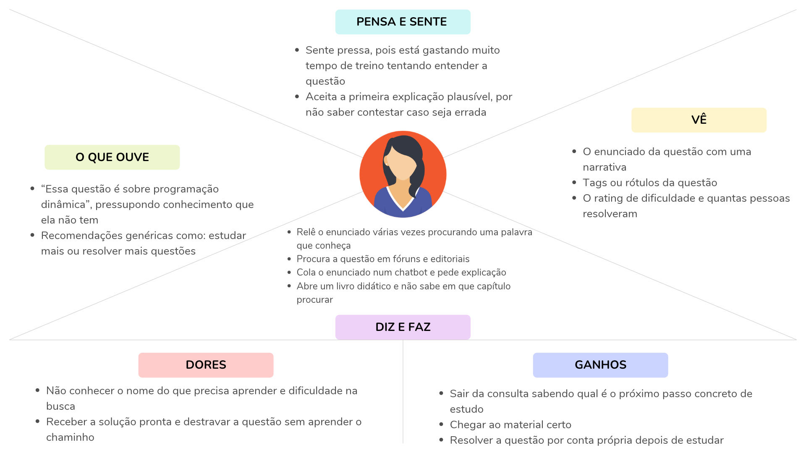

# Entrega 3: Personas, mapa de empatia, contexto de uso e jornada

**Data:** 09/09/2026 - finalizada em 02/11/2026

**Status:** `🟦 revisada após feedback`

**Responsabilidade:** 1 persona por integrante; 1 mapa de empatia, 1 contexto de uso consolidado e 1 jornada por equipe (salvo orientação diferente do docente).

## Objetivo da atividade

Representar grupos de usuários de forma útil para decisões de design. Persona não é personagem decorativo: suas características devem alterar requisitos, prioridades, linguagem, fluxos ou critérios de avaliação.

## Atenção a projetos técnicos

Em TCCs sem interface original, a persona pode representar um **profissional que se apropria da contribuição técnica**: DBA, analista, cientista de dados, administrador, pesquisador, técnico, operador, gestor ou especialista de domínio.

Não escolha um perfil apenas porque “parece combinar” com a tecnologia. Explique **qual objetivo esse perfil teria e qual parte da contribuição do TCC produziria valor para ele**. Se ainda for hipótese, mantenha como hipótese/proto-persona a validar.

Também considere papéis diferentes quando houver tarefas distintas, por exemplo:

- operador que executa análises;
- administrador que configura e gerencia permissões;
- especialista que interpreta resultados;
- gestor que consulta relatórios e decide;
- auditor que revisa histórico.

## Entradas da Entrega 1

Antes de criar personas, retome os tipos de usuários, características relevantes, objetivos e hipóteses registradas na Entrega 1. A persona **não deve transformar uma hipótese inicial em fato por meio de uma história fictícia**.

| Item da Entrega 1 | Status inicial | Evidência disponível agora | Como será tratado nesta entrega |
|---|---|---|---|
| Aluno iniciante em programação competitiva | [F] como público-alvo; [?] Q02 quanto ao que "iniciante" significa | Público-alvo declarado da aplicação e do TCC. É uma suposição construída da observação, ainda não verificada | incorporar como proto-persona primária (P01), mantendo Q02 aberta |
| Tutor / treinador | [H] H11: a equipe não tem evidência de que tutores usariam a ferramenta | Nenhuma. A Entrega 1 decidiu que o tutor **não influencia decisões de interface** enquanto H11 não for investigada | incorporar como proto-persona secundária (P02), subordinada a P01. Suas metas ficam provisórias enquanto H11 não for investigada |
| Pesquisador | [H] H04 | Nenhuma | descartar: consome o artefato técnico do TCC, não a interface. Fora do recorte de IHC |
| A atividade mais frequente é a consulta feita por um aluno para descobrir os tópicos de uma determinada questão. | [H] H08 | Nenhuma evidência sobre o padrão de consumo do aluno | Continua hipótese. Ser a funcionalidade principal da ferramenta é uma decisão de produto, não prova de que é a atividade mais frequente do aluno. A equipe adota a consulta como fluxo principal por decisão de projeto, a revisar com os dados da Entrega 7 (H08, Q04) |

## 1. Personas

### Persona P01: Alfreda Marta

**Autor(a):** Sebastian Citta, 24.123.068-9
**Tipo:** **primária**: é a persona que dirige as decisões de design
**Base de evidências:** **proto-persona**: construída a partir do público-alvo declarado no TCC e das hipóteses da Entrega 1. Nenhuma observação, entrevista ou questionário foi realizado.
**Hipóteses da Entrega 1 relacionadas:** H06, H07, H08, H09, H12, H17, H19, H21, H22, e as lacunas Q02, Q06, Q09, Q11, Q12

| Campo | Descrição | Status |
|---|---|---|
| Faixa etária / contexto relevante | 18 a 25 anos, graduação em andamento | [H] |
| Ocupação/papel | Estudante de Ciência da Computação | [H] |
| Momento do curso | 3º semestre. Já cursou algoritmos e estruturas de dados básicas; ainda não cursou grafos nem programação dinâmica | [H] Q02 |
| Experiência anterior em programação competitiva | Começou a treinar há cerca de 6 meses. Resolve questões fáceis do Codeforces, mas trava nas de dificuldade média | [H] Q02 |
| Relação com equipe | Participa dos treinos abertos do time de maratona da faculdade | [H] Q11 |
| Rotina e hábitos de treino | Treina sozinha 2 ou 3 noites por semana, em sessões de 30 minutos até 1 hora, em casa. Nos treinos do time, resolve a mesma lista que os colegas | [H] H09, Q10 |
| Disponibilidade de tempo | Divide o tempo com as disciplinas do curso. Cada sessão de treino é curta, então perder 10 minutos travada pesa | [H] H22 |
| Conhecimento de programação | Moderado: já programa, conhece estruturas básicas e resolve questões fáceis sem ajuda | [H] |
| Conhecimento do domínio (programação competitiva) | Baixo: não reconhece pelo enunciado qual técnica algorítmica a questão exige, nem conhece os pré-requisitos de cada tópico | [H] H06: esta é a distinção que define a persona. |
| Familiaridade com algoritmos | Conhece nomes de tópicos que já viu em disciplina; não domina os que ainda não estudou | [?] Q02 |
| Experiência com juízes online | Já submete soluções no Codeforces e entende o veredito | [H] H17 |
| Vocabulário | Lê inglês técnico, mas não necessariamente associa `dp`, `greedy` ou `constructive algorithms` a um conteúdo que saiba estudar | [?] Q02, [H] H05 |
| Experiência tecnológica | Alta: opera interfaces web sem dificuldade e usa LLMs no cotidiano | [H] H06, H19 |
| Objetivos | Destacar-se no curso e na profissão; progredir no treino de programação competitiva | [H] |
| Necessidades | Descobrir **o que lhe falta saber** para resolver a questão em que travou, sem receber a solução pronta | [H] H07 |
| Dores/frustrações | Trava numa questão e não sabe nem o nome do que precisa procurar; perde tempo de treino tentando por eliminação | [H] H17  |
| Motivadores | Conseguir um bom emprego, aproveitar o curso, não ficar para trás da equipe | [H] |
| Restrições/acessibilidade | **Não investigado**: a equipe não sabe se há necessidade de contraste, navegação por teclado, leitor de tela ou alternativa textual a uma representação gráfica | [?] Q03 |
| Dispositivo | Notebook ou desktop, porque o enunciado está em outra aba e o código na mesma máquina | [H] H21, [?] Q09 |
| Ambiente típico de uso | Treino individual, sozinha, sem tutor presente | [H] H09 |
| Estado em que chega ao sistema | **Já travada e já frustrada**, durante ou logo após uma tentativa que falhou | [H] H22: *condiciona o que precisa estar visível na primeira tela* |

**Necessidades que P01 impõe ao projeto:**

| # | Necessidade da persona | Hipótese/lacuna que a sustenta | Consequência para o design |
|---|---|---|---|
| N01 | Começar a consulta sem precisar decidir nada antes, porque ela chega travada e sem repertório para escolher opções | H22, Q15 | A ação inicial precisa ser única: sustenta F01 e RC01 da Entrega 2 |
| N02 | Saber o que estudar **em que ordem**, não apenas quais são os assuntos | H07; [F] lacuna declarada na implementação do TCC | Sustenta F03 e a decisão de mostrar a trilha em grafo |
| N03 | Chegar ao material de estudo sem já saber o nome do assunto | H17 | Sustenta F04, e explica por que o padrão de filtro por tag do Codeforces não serve (H13) |
| N04 | Saber se pode confiar no que vai estudar, já que não tem repertório para julgar uma explicação | H06, H16 | Sustenta F05: cada tópico vem com livro e capítulo de uma fonte consolidada, ao contrário do chatbot, que na consulta observada não citou livro nem capítulo (Entrega 2, C02). A fonte garante o conteúdo, não a escolha do tópico, por isso o aviso de que a IA pode errar continua |
| N05 | Entender os termos da resposta, que chegam em jargão e em inglês | H05, Q02, Q06 | Mantém a ajuda contextual/glossário `em aberto`, e RC03 como provisória |
| N06 | Não ficar sem saber se o sistema está trabalhando, dada a latência do modelo | [F] latência do LLM (Entrega 1, 9.3) | Sustenta F02 |

### Persona P02: José Carlos Trunchado

**Autor(a):** Juan Manuel Citta, 24.123.022-6
**Tipo:** **secundária**: atendida pela mesma interface de P01, com necessidades próprias que cabem nela
**Base de evidências:** **proto-persona**: nenhuma conversa com professores ou treinadores foi realizada
**Hipóteses da Entrega 1 relacionadas:** H11, e as lacunas Q01, Q11

| Campo | Descrição | Status |
|---|---|---|
| Faixa etária / contexto relevante | 30 a 60 anos | [H] |
| Ocupação/papel | Professor de faculdade; eventualmente treinador de equipe de maratona | [H] H11 |
| Conhecimento do domínio | Especialista: reconhece a técnica exigida lendo o enunciado | [H] |
| Experiência tecnológica | Extensa | [H] |
| Objetivos | Melhorar a experiência de aprendizagem dos alunos e o aproveitamento da própria aula | [H] |
| Necessidades | Ensino eficiente e correto; confiar no material antes de repassá-lo | [H] H11 |
| Dores/frustrações | Turmas grandes, pouco tempo de aula, dificuldade de atender individualmente quem travou | [H] |
| Motivadores | Reputação própria e da instituição; resultado dos alunos | [H] |
| Restrições/acessibilidade | Não investigado | [?] Q03 |
| Ambiente típico de uso | Sala de aula e preparação de treino | [H] |
| Comportamentos relevantes | Procura se manter atualizado; verifica fontes | [H] H11 |

**Por que P02 é secundária**

O critério adotado é o de interface própria: uma persona é primária quando não pode ser atendida pela interface projetada para outra.

A tarefa de P02, conferir a fonte de cada tópico antes de recomendar o material, é realizada na mesma interface de P01, sem login, sem permissão e sem tela exclusiva. P01 também precisa ver a fonte de cada tópico (N03), por um motivo diferente: saber onde estudar. A mesma tela atende aos dois objetivos.

Isso caracteriza persona secundária, e não ausência de relevância. A diferença entre os dois perfis está na tarefa, não na interface.

A classificação mudaria se o escopo passasse a incluir o histórico de consultas por aluno, o que exigiria identificação e controle de acesso, portanto uma interface própria. Essa possibilidade está registrada como fora do escopo na Entrega 9.

**H11 e a classificação são coisas separadas.** H11 pergunta se tutores adotariam a ferramenta, e continua aberta. A classificação de P02 como secundária não depende de H11: depende do teste de interface própria, que já pode ser aplicado hoje. Já as metas de P02 dependem de H11: a tarefa T02 e as metas MU04 e MU05 ficam provisórias, fora da priorização e sem orientar decisões de interface até H11 ser investigada (Entrega 8).

| Exigência | Hipótese | Observação |
|---|---|---|
| Fontes pedagógicas verificáveis por tópico | H11 | **Converge com N03/N04 de P01.** A mesma tela atende aos dois, por motivos diferentes. É o que sustenta a classificação secundária |
| Exportar ou compartilhar uma trilha com a turma | [?] Q11 | Ainda está em análise se fará parte da aplicação. Por hora não tem tarefa atribuída. |

### Síntese das personas

| | P01 (Alfreda Marta) | P02 (José Carlos Trunchado) |
|---|---|---|
| Papel | **Primária** | Secundária |
| Conhecimento do domínio | **Baixo**: não reconhece a técnica pelo enunciado | Alto: reconhece e valida |
| Objetivo | Destravar e voltar a progredir no próprio treino | Melhorar o aprendizado de uma turma |
| Relação com o resultado da ferramenta | **Consome e não consegue auditar** (H06) | Audita antes de repassar (H11) |
| Contexto | Sozinha, travada, em treino individual | Sala de aula ou preparação de treino |
| Pressão | Tempo de treino perdido | Tempo de aula e tamanho da turma |
| **Precisa de interface própria?** | **Sim**, a interface é projetada a partir dela | **Não**, usa a mesma de P01 |
| Influencia o design nesta disciplina? | **Sim, integralmente** | **De forma subordinada e provisória.** Pode gerar tarefa e metas na mesma interface, sem alterar o que P01 precisa. As metas só passam a valer se H11 for sustentada |

**Persona prioritária: P01.** Pelo público-alvo declarado no TCC, por ser o perfil com evidência documental de existência, por ser acessível à equipe para as Entregas 7 e 14, e por concentrar a tensão de IHC do projeto, com alta competência tecnológica e baixa competência de domínio.

[?] Q02: Enquanto não se souber o que "iniciante" significa concretamente neste domínio, P01 permanece uma aposta. Um aluno de primeiro ano e um competidor de terceiro ano têm repertórios muito diferentes, e a persona atual pode estar descrevendo um ponto médio que não existe.

## 2. Mapa de empatia (equipe)

**Persona escolhida:** P01
**Justificativa:** é a persona primária e o público-alvo declarado do TCC.

| Quadrante | Conteúdo | Status |
|---|---|---|
| O que vê | O enunciado da questão, com uma narrativa que não indica a técnica necessária | [F] |
| | Tags da questão, quando visíveis (em competição ficam ocultas) | [F] |
| | O *rating* de dificuldade e quantas pessoas resolveram | [F] observado em C01-2 |
| | Colegas de equipe resolvendo questões que ela não resolve | [H] |
| O que ouve | "Isso é só DP", "é um problema clássico de grafos", são explicações que pressupõem o conhecimento que ela não tem | [H] |
| | Recomendações genéricas de "resolver mais questões" | [H] |
| O que diz e faz | Relê o enunciado várias vezes procurando uma palavra que reconheça | [H] H17 |
| | Procura a questão em fóruns e editoriais | [H] H18 |
| | Cola o enunciado num chatbot e pede explicação | [H] H19 |
| | Abre um livro didático e não sabe em que capítulo procurar | [H] N03 |
| **O que pensa e sente** | "Não sei nem o que pesquisar" | [H] N03 |
| | Insegurança sobre a própria capacidade, não necessariamente sobre o conteúdo | [H] |
| | Pressa: o tempo de treino está passando | [H] H22 |
| | Aceita a primeira explicação plausível, por não ter como contestá-la | [H] H06 |
| Dores | Não conhecer o nome do que precisa aprender. Busca vira tentativa e erro | [H] N03 |
| | Receber a solução pronta e destravar a questão sem aprender o caminho | [H] H18 |
| Ganhos | Sair da consulta sabendo qual é o próximo passo concreto de estudo | [H] H07 |
| | Chegar ao material certo sem já saber o nome do assunto | [H] N03 |
| | Resolver a questão por conta própria depois de estudar | [H] H07 |

## 3. Contexto de uso (consolidação)

| Dimensão | Descrição | Status | Implicação de design |
|---|---|---|---|
| Usuários | Aluno iniciante em programação competitiva (P01). Tutor (P02) secundário, subordinado a P01, com metas provisórias até H11 ser investigada | [F] público-alvo do TCC; [?] Q02 quanto ao perfil concreto | Toda decisão de linguagem e explicação é calibrada para baixo conhecimento de domínio |
| Tarefas | A01: descobrir o que precisa saber para resolver uma questão em que travou | [F] a atividade existe; [H] H08 quanto à frequência | Fluxo único e principal; sem exploração de acervo |
| Equipamentos | Notebook ou desktop, com o enunciado em outra aba | [H] H21; [?] Q09 | Condiciona a viabilidade do grafo. Se o uso em celular for relevante, a visualização em lista, já implementada, é a alternativa |
| Ambiente físico: local | Casa, laboratório da faculdade ou sala de treino do time | [?] Q10 | Nenhuma implicação derivada enquanto a lacuna estiver aberta |
| Ambiente físico: posto de trabalho | Hipótese: notebook em mesa fixa, uma tela, com juiz online, editor de código e material de consulta em janelas ou abas alternadas. Não se sabe se há segundo monitor | [H] H21, H23; [?] Q09 | Se houver uma tela só, a trilha disputa espaço com o enunciado e o editor. A Entrega 7 (perguntas 9 e 10 do questionário) investiga isso |
| Ambiente físico: celular e interrupções | Hipótese: o celular fica ao lado e gera notificações; em casa pode haver ruído e interrupções da família; no laboratório, conversa de colegas | [H] H23 | Se a interrupção for frequente, a aluna precisa retomar a consulta de onde parou. A investigação contextual da Entrega 7 registra interrupções |
| Ambiente físico: iluminação, ergonomia e conexão | Não investigado | [?] Q10 | Lacuna registrada. Conexão já é requisito (linha "Conexão" abaixo) |
| Momento e estado | O aluno chega **já travado e frustrado**, durante ou após uma tentativa que falhou | [H] H22 | A primeira tela precisa aceitar a questão imediatamente, sem etapa de configuração (N01) |
| Pressão de tempo | Em treino, moderada| [H] H22 | Não tem urgência na interface. A competição não será o foco principal da interface. |
| Ambiente social/organizacional | Estudo individual, sem tutor presente | [H] H09 | A interface precisa ser autoexplicativa: possivelmente o aluno esteja sozinho |
| | Pode existir equipe de maratona com treinador | [?] Q11 | Nenhuma consequência adotada |
| | Sessão individual ou coletiva: em casa treina sozinha; nos treinos do time, colegas estão na mesma sala resolvendo a mesma lista | [H] H09, H10 | Se o uso ocorrer em sala com colegas, o que aparece na tela pode ser visto por outros |
| | Ajuda entre colegas: pode haver grupos de Discord ou WhatsApp do time; não se sabe se pedir ajuda durante o treino é bem visto | [?] Q11 | Se pedir ajuda for constrangedor, uma consulta discreta e individual tem mais valor. A Entrega 7 investiga isso |
| | Competição entre colegas: o time compara desempenho, e mostrar que travou pode expor a aluna | [H] | Reforça manter a consulta sem login e sem compartilhamento automático (Entrega 1) |
| | Papel do treinador: não se sabe se o treinador incentiva ou desencoraja buscar ajuda externa durante o treino | [?] Q11, H11 | Pode mudar quando e como a ferramenta é usada; depende da investigação de H11 |
| Papéis/permissões/governança | Nenhum papel previsto no recorte adotado | [F] decorre de H09 | Sem login, perfis ou permissões |
| Acessibilidade | **Não investigado** | [?] Q03 | Requisitos serão definidos na Entrega 8. Uma alternativa textual à representação gráfica já se desenha como provável necessidade |
| Volume de dados/histórico | Uma trilha pode ser consumida ao longo de dias, não de uma sessão | [?] Q12 | Se Q12 for sustentada, retomar a trilha consultada vira necessidade. Histórico é uma solução possível, não um requisito definido |
| Conexão | Necessária; sem conexão não há consulta | [F] arquitetura web | - |
| Idioma | O modelo foi treinado sobre enunciados em inglês e devolve tópicos em inglês | [F] implementação do TCC | Possível barreira de vocabulário (H05, N05); mantém RC03 provisória |

## 4. Jornada do usuário (equipe)

**Persona:** P01 (Alfreda Marta)
**Objetivo da jornada:** resolver, por conta própria, uma questão de programação competitiva em que travou
**Início e fim da jornada:** começa **antes** do contato com a ferramenta, no momento em que ela escolhe a questão e tenta resolvê-la; termina **depois**, quando ela retorna à questão tendo estudado, ou desiste dela.

| Etapa | Fase | Situação/ação | Objetivo | Pensamento/emoção | Dor | Oportunidade de design | Evidência |
|---|---|---|---|---|---|---|---|
| 1 | antes | Escolhe uma questão para treinar, pela dificuldade ou pela lista da competição | Progredir no treino | Confiança, expectativa | - | - | [H] |
| 2 | antes | Lê o enunciado e tenta identificar a abordagem | Entender o que a questão pede | Concentração | A narrativa do enunciado não indica a técnica necessária | - | [F] formato observado no Codeforces |
| 3 | antes | Tenta resolver e falha, ou não consegue nem começar | Resolver | Dúvida, depois frustração | Não sabe se o problema é a lógica ou um conteúdo que desconhece | - | [H] |
| 4 | antes | **Percebe que está travada** e que não vai sair sozinha | Decidir o que fazer | Frustração, urgência | Não existe um sinal claro de "você está travada por falta de conteúdo X" | É aqui que a necessidade do produto nasce | [?] Q16: não sabemos quando nem como ela percebe isso, nem quanto tempo passa antes |
| 5 | antes | Decide buscar ajuda externa e escolhe onde: tags, editorial, fórum ou chatbot | Encontrar orientação | Esperança misturada com receio de ver a solução | Cada caminho tem um custo: a tag não ensina, o editorial entrega a resposta, o chatbot não cita fonte | Ser uma opção diferente, com fontes declaradas e confiáveis | [H] H17, H18, H19 |
| 6 | antes | Procura o assunto num livro e não sabe em que capítulo | Estudar o conteúdo certo | Desorientação | O material é organizado por assunto, e ela não sabe o nome do assunto | Ligar cada tópico a uma fonte específica (N03) | [H] N03 |
| 7 | durante | Apresenta a questão ao sistema | Iniciar a consulta | Alívio por haver um caminho simples | Qualquer decisão pedida aqui é uma decisão que ela não tem informação para tomar | Ação inicial única, sem configuração prévia (N01) | [H] H22; [?] Q15 |
| 8 | durante | Aguarda o processamento | Saber que está funcionando | Impaciência: ela já estava frustrada antes de chegar | Sem retorno, não distingue "processando" de "travou" | Feedback de estado (N06) | [F] latência do LLM  |
| 9 | durante | Recebe a trilha e tenta entendê-la | Saber o que estudar e em que ordem | Expectativa, depois possível sobrecarga | Uma lista de tópicos sem ordem nem relação não diz por onde começar | Tornar visível a dependência entre tópicos (N02) | [F] lacuna encontrada na pesquisa do TCC |
| 10 | durante | Encontra termos que não reconhece | Compreender o que foi indicado | Insegurança | Jargão em inglês para quem por definição ainda não domina o assunto | Ajuda contextual, tópico tem rótulo de `em aberto` ou `já estudado` (N05) | [H] H05; [F] rótulos (tags) em inglês |
| 11 | durante | **Tenta avaliar se pode confiar na trilha** | Não perder tempo com orientação errada | Dúvida que ela não consegue resolver | Não tem repertório para contestar; tende a aceitar a primeira explicação plausível | Fonte consolidada em cada tópico e aviso de que a IA pode errar (N04) | [H] H06; [F] F1 do núcleo de 0,82 e alucinação registrada |
| 12 | durante | Decide por onde começar | Ter um próximo passo concreto | Alívio ou ainda dúvida | - | O resultado da consulta precisa terminar numa ação, não numa lista | [H] H07 |
| 13 | depois | Estuda o tópico no material indicado | Adquirir o conhecimento que faltava | Esforço, progresso | O material pode ser mais extenso do que o tempo disponível | Indicar o recorte do material, não só o livro | [H] N03 |
| 14 | depois | Volta à questão e tenta de novo | Resolver por conta própria | Determinação | Não sabe se já estudou o suficiente para tentar novamente | - | [?] **Q17: não sabemos como ela decide que já sabe o bastante para voltar** |
| 15 | depois | **Caso resolva:** confirma que o caminho funcionou | Confiar na ferramenta na próxima vez | Satisfação, confiança | - | É o momento que constrói adoção da ferramenta | [H] |
| 16 | depois | **Caso não resolva:** reavalia se o problema era o conteúdo indicado ou a própria execução | Entender o que faltou | Desânimo | Pode concluir que é incapaz, quando a trilha estava errada | Permitir voltar e questionar a orientação recebida | [H] H06 |
| 17 | depois | Dias depois, retoma o estudo do mesmo assunto | Continuar a trilha | Vontade de continuar de onde parou | Se fechou a aba, perdeu o resultado e precisa refazer a consulta | Permitir retomar a trilha consultada. Histórico é uma solução possível, a decidir por Q12 | [?] Q12 |
| 18 | depois | Usa o que aprendeu em questões novas | Não travar de novo pelo mesmo motivo | Confiança, sensação de progresso | Pode não reconhecer o mesmo tópico em outro enunciado | Benefício final da jornada: conhecimento que serve para questões futuras, não só para esta | [H] H07 |

> A jornada pode incluir etapas **antes, durante e depois** do uso do produto. Não transforme a jornada em lista de telas.

**Narrativa da jornada**

Alfreda está no 3º semestre e começou a treinar programação competitiva há uns seis meses. Numa noite de semana, em casa, abre o Codeforces para treinar por uma hora e escolhe uma questão de dificuldade média, um pouco acima do que costuma resolver.

Ela lê o enunciado, que conta uma história sobre caminhos numa cidade, e não reconhece nenhuma técnica. Tenta uma solução, envia e recebe "resposta errada". Tenta de novo e falha outra vez. Depois de meia hora, percebe que não é um erro de código: falta algum conteúdo que ela não sabe nomear.

Ela olha as tags da questão e vê `dp` e `graphs`, mas não sabe o que estudar a partir disso. Pensa em abrir o editorial, mas não quer ver a solução pronta. Pensa em perguntar a um chatbot, mas já recebeu explicações que pareciam certas e não eram. Abre o livro da disciplina e não sabe em que capítulo procurar.

Então cola o enunciado na ferramenta. Vê que a consulta está sendo processada e, em poucos segundos, recebe uma trilha: os tópicos que precisa estudar, a ordem entre eles e o capítulo do livro onde está cada um. Alguns termos estão em inglês, e ela consulta a explicação curta de cada um. Ela não tem como saber se a trilha está certa, então confere a fonte indicada antes de começar.

Escolhe o primeiro tópico da trilha e estuda o capítulo indicado naquela noite e na seguinte. Quando sente que entendeu, volta à questão e tenta de novo. Se resolver, passa a confiar na ferramenta e reconhece o mesmo tópico quando ele aparece em outra questão. Se não resolver, fica na dúvida se o problema era o seu código ou uma trilha errada.

A narrativa usa as mesmas hipóteses da tabela. Em especial, o tempo até perceber que travou (Q16), como ela decide que estudou o suficiente (Q17) e se ela volta à trilha em outro dia (Q12) ainda não foram investigados.

**O que a jornada revelou:**

- **Das 18 etapas, 6 são "antes" do contato com a ferramenta**, e é onde estão as duas lacunas novas (Q16, Q17) e a principal lacuna do projeto (Q06). O produto só é útil se a etapa 4 for bem compreendida.
- **A etapa 11 é o ponto crítico.** É onde H06 e o F1 do núcleo de 0,82 se encontram: o sistema erra com frequência conhecida e a usuária não tem como perceber. Nenhuma outra etapa concentra tanto risco.
- **A etapa 16 é a consequência real do erro**, e não "perder tempo": a aluna pode atribuir a si mesma uma falha que foi do sistema.

## Síntese

**Necessidades e objetivos que devem obrigatoriamente aparecer nos cenários (Entrega 4) e nas tarefas (Entrega 5):**

1. **O objetivo é destravar e voltar a resolver por conta própria** (H07, N02), e não "receber uma lista de tópicos" nem "usar o modelo". Um cenário que termine na entrega da trilha está incompleto: precisa ir até a etapa 14.
2. **A tarefa não começa em "colar o enunciado"** (etapas 1 a 6). A decomposição da Entrega 5 precisa incluir o que acontece antes do contato com o sistema, ou vai modelar a interface em vez da atividade.
3. **A incapacidade de julgar o resultado é a característica definidora da persona** (H06, etapa 11, N04). Qualquer cenário ou tarefa que suponha uma usuária capaz de validar a trilha está descrevendo P02, não P01.
4. **A fonte pedagógica por tópico resolve uma dor específica** (N03): ela não sabe o nome do assunto, logo não sabe onde procurar.
5. **Vocabulário tem que atender a suposição feita em H05 e ser inteligível para baixo conhecimento de domínio**

## Checklist

- [x] Existe pelo menos uma persona por integrante. 
- [x] As personas não são apenas diferenças demográficas superficiais. 
- [x] Está claro o que é dado real e o que é hipótese/proto-persona.
- [x] A persona não “validou por ficção” uma hipótese da Entrega 1; afirmações continuam marcadas como hipótese quando não há evidência. 
- [x] Objetivos e dores têm consequência para o design. 
- [x] Contexto de uso está coerente com a Entrega 1. 
- [x] Em TCC sem interface original, a persona possui relação explícita com a contribuição técnica. 
- [x] Papéis administrativos, técnicos e decisórios só foram criados quando possuem objetivos/tarefas diferentes. 
- [x] Jornada possui etapas, dores e oportunidades e não é apenas wireflow. 
- [x] IDs das personas foram adicionados à rastreabilidade. 
- [x] Artefatos visuais salvos em `assets/03_personas/`. 
