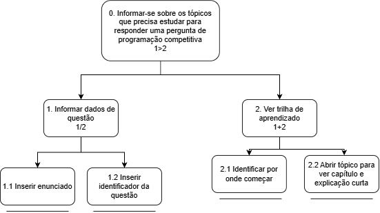
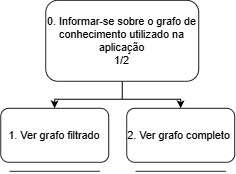
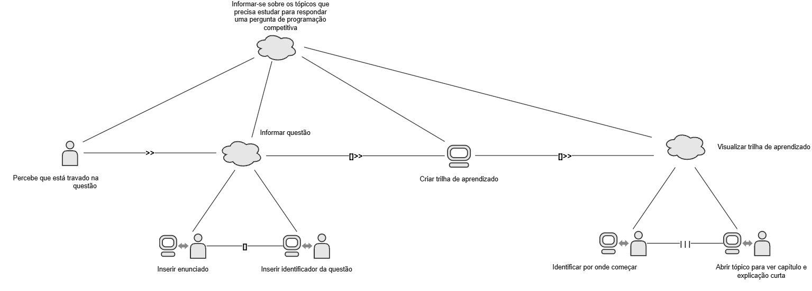
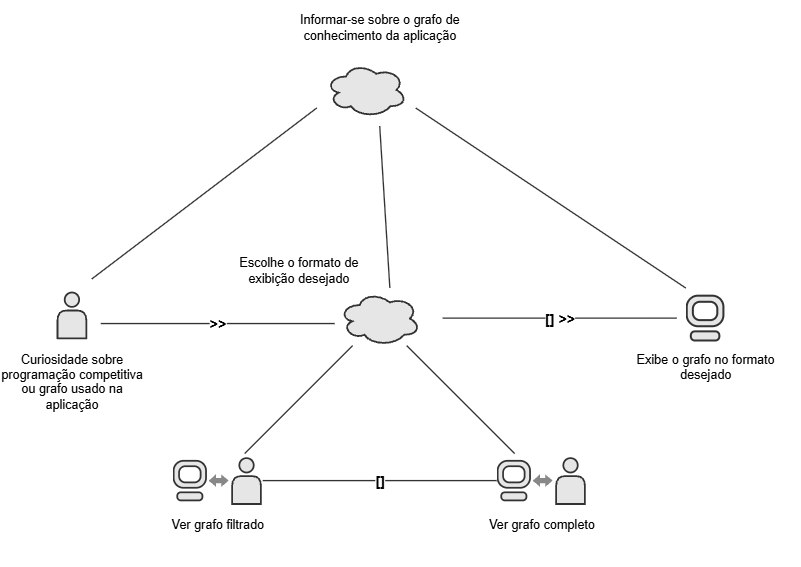

# Entrega 5 - Análise de tarefas: HTA, GOMS e CTT

**Data:** 25/10/2026, revisada em 11/11/2026
**Status:** `🟦 revisada após feedback`   
**Responsabilidade:** cada integrante modela pelo menos 1 HTA, 1 GOMS e 1 CTT. As três técnicas podem abordar a mesma funcionalidade ou funcionalidades distintas, conforme a orientação da disciplina.

## Objetivo da atividade

Modelar tarefas importantes sob perspectivas complementares: decomposição hierárquica (HTA), estrutura de metas/métodos/operações (GOMS) e relações temporais entre tarefas (CTT). O diagrama deve ser acompanhado de interpretação textual.

## Para projetos cujo TCC não previa interface

Modele **tarefas humanas relacionadas ao uso da contribuição técnica**, e não a implementação interna do algoritmo. Exemplos de boas tarefas para análise:

- investigar uma consulta de baixo desempenho;
- configurar uma análise e selecionar parâmetros;
- submeter um dataset e verificar sua validade;
- acompanhar uma execução demorada;
- comparar dois resultados/modelos;
- interpretar uma recomendação e decidir se a aceita;
- localizar uma execução anterior usando busca/filtros;
- gerar e compartilhar um relatório;
- administrar papéis/permissões quando isso for parte do trabalho real;
- revisar um alerta e registrar uma decisão.

Um CRUD pode gerar tarefas relevantes, mas “cadastrar usuário” só merece modelagem se tiver significado no domínio (papéis, validações, riscos, permissões, dependências).

## Seleção das tarefas

| ID | Tarefa | Persona/cenário de origem | Frequência/criticidade | Autor responsável |
|---|---|---|---|---|
| T01 | Informar-se sobre os tópicos que precisa estudar para responder uma pergunta de programação competitiva  | C01 e P01 | Uso mais frequente e crítico da aplicação [H08] e [H16] | Sebastian Citta |
| T02 | Informar-se sobre o grafo de conhecimento utilizado na aplicação  | C02, P01, P02 | Comparado a T01 tem menos frequência e criticidade. Por decisão do produto é uma funcionalidade (ou tarefa) secundária | Juan Manuel Citta |

T02 entra na modelagem, pois o acesso ao grafo de conhecimento que é usado de fonte na aplicação é também de interesse de P01, uma vez que pode enxergar todo os tópicos da programação competitiva em uma só tela. Isso classifica a tarefa como secundária, porém é de uso das duas Personas.

> Priorize tarefas necessárias para que o usuário alcance objetivos centrais. Não desperdice a modelagem em ações triviais isoladas, como “clicar em login”, se o objetivo relevante é maior. Da mesma forma, não modele o funcionamento interno do algoritmo como se fosse uma tarefa humana.

---

## HTA - T01 Informar-se sobre os tópicos que precisa estudar para responder uma pergunta de programação competitiva

**Autor(a):** Sebastian Citta - 24.123.068-9

### Descrição da tarefa

O objetivo da tarefa é sanar as dúvidas sobre programação competitiva do usuário. 
O ponto de início é o usuário entrar com o enunciado ou o identificador da questão no campo de texto.
A conclusão esperada é uma trilha de aprendizado, com qual o usuário pode interagir para abrir um tópico específico.
A tarefa ocorre dentro da página principal da aplicação.

### Diagrama

### Decomposição e planos

| ID | Objetivo/operação | Plano/ordem | Problema ou decisão de design observada |
|---|---|---|---|
| 0 | Informar-se sobre os tópicos que precisa estudar para responder uma pergunta de programação competitiva | 1 > 2; Plano: Informar questão e depois mostrar a trilha.| Input: Caixa de texto com mensagem para inserir o enunciado ou identificador da questão no site CodeForces. Feedback: Trilha de aprendizado em formato de grafo. Recomendação: exibir indicador de carregamento enquanto o grafo é gerado. |
| 1 | Informar dados de questão | 1 / 2 | Decisão: oferecer duas formas alternativas de entrada (enunciado ou identificador), já que nem sempre o usuário tem o enunciado completo à mão. O usuário escolhe apenas uma. |
| 1.1 | Inserir enunciado | - | Problema: enunciados longos são trabalhosos de digitar. Recomendação: usar campo de texto multilinha que facilite colar o texto. |
| 1.2 | Inserir identificador da questão | - | Problema: o usuário pode não saber o formato esperado do identificador. Recomendação: incluir exemplo (placeholder) e validar o formato. |
| 2 | Ver trilha de aprendizado | 1 + 2 | Decisão: a trilha de aprendizado é apresentada como grafo e o usuário pode escolher abrir um painel ao lado da trilha, com informações adicionais do tópico. Problema: grafos grandes podem ser difíceis de navegar. Recomendação: Permitir zoom. |
| 2.1 | Identificar por onde começar | - | - |
| 2.2 | Abrir tópico para ver capítulo e explicação curta | - | Decisão: o painel mostra livro e capítulo da fonte e o aviso de que a IA pode errar (H06). |

## HTA - T02 Informar-se sobre o grafo de conhecimento utilizado na aplicação

**Autor(a):** Juan Manuel Citta - 24.123.022-6

### Descrição da tarefa
O objetivo da tarefa é permitir que o usuário conheça as fontes utilizadas pelo modelo, além da estrutura do grafo de conhecimento utilizado pela aplicação.
O ponto de início é o usuário acessar a seção do grafo de conhecimento a partir da aplicação.
A conclusão esperada é o usuário ter visto o grafo de conhecimento da programação competitiva completo ou filtrado .

### Diagrama

### Decomposição e planos

| ID | Objetivo/operação | Plano/ordem | Problema ou decisão de design observada |
|---|---|---|---|
| 0 | Informar-se sobre o grafo de conhecimento utilizado na aplicação| 1 / 2 | Input: o usuário acessa a seção de grafo de conhecimento a partir da página onde informa o enunciado. Feedback: Grafo completo de conhecimento exibido na tela com opções de filtro. Plano: Ver o grafo completo ou filtrar por tópico. Recomendação: Deixar opções para ajustar o grafo a tela e/ou outras opções de Zoom. |
| 1 | Ver grafo filtrado | - | Decisão: apresentar o grafo filtrado por tópicos (exemplo: Fundamentos algorítmicos). |
| 2 | Ver grafo completo | - | Decisão: mostrar o grafo completo. Problema: grafos grandes são difíceis de navegar e de ler. Recomendação: permitir zoom, filtro por tópico e destaque ao selecionar um nó. |

**Verificação do HTA:**

- O objetivo 0 representa uma meta do usuário?
- As subtarefas são necessárias e suficientes?
- Os **planos** indicam ordem, alternativa, repetição ou condição?
- A decomposição parou em nível útil para projeto de interação?

---

## GOMS - T01 Informar-se sobre os tópicos que precisa estudar para responder uma pergunta de programação competitiva

**Autor(a):** Sebastian Citta - 24.123.068-9

### Goal

GOAL 0: sanar dúvidas sobre programação competitiva obtendo uma trilha de aprendizado em grafo

### Métodos, operadores e regras de seleção

GOAL 1: informar a questão à aplicação

METHOD 1.A: informar a questão pelo enunciado (SEL. RULE: o usuário tem o enunciado em mãos e não lembra o identificador da questão)
- OP. 1.A.1: copiar o enunciado da questão no site CodeForces
- OP. 1.A.2: deslocar o cursor do mouse para o campo de texto da página principal
- OP. 1.A.3: clicar com o botão esquerdo do mouse no campo de texto
- OP. 1.A.4: colar o enunciado no campo de texto
- OP. 1.A.5: verificar se o enunciado foi inserido por completo
- OP. 1.A.6: pressionar a tecla Enter (ou clicar no botão de envio)
- OP. 1.A.7: verificar que a aplicação entrou em processamento

METHOD 1.B: informar a questão pelo identificador (SEL. RULE: o usuário sabe o identificador da questão, o que é mais rápido que copiar um enunciado longo)
- OP. 1.B.1: localizar o identificador da questão no site CodeForces
- OP. 1.B.2: deslocar o cursor do mouse para o campo de texto da página principal
- OP. 1.B.3: clicar com o botão esquerdo do mouse no campo de texto
- OP. 1.B.4: digitar o identificador da questão
- OP. 1.B.5: verificar se o identificador está correto
- OP. 1.B.6: pressionar a tecla Enter (ou clicar no botão de envio)
- OP. 1.B.7: verificar que a aplicação entrou em processamento

GOAL 2: visualizar a trilha de aprendizado
- OP. 2.1: aguardar a geração da trilha
- OP. 2.2: verificar que a aplicação gerou a trilha
GOAL 2.1: identificar por onde começar
- OP. 2.1.1: localizar na trilha o primeiro tópico
- OP. 2.1.2: verificar que entendeu por onde começar
GOAL 2.2: abrir tópico para ver capítulo e explicação curta
- OP. 2.2.1: deslocar o cursor do mouse para o tópico desejado que se encontra na trilha
- OP. 2.2.2: clicar com o botão esquerdo do mouse 
- OP. 2.2.3: verificar que encontrou o capítulo e a explicação do tópico

---

## GOMS - T02 Informar-se sobre o grafo de conhecimento utilizado na aplicação

**Autor(a):** Juan Manuel Citta - 24.123.022-6

### Goal

GOAL 0: conhecer o grafo de conhecimento utilizado pelo modelo para gerar as trilhas de aprendizado

### Métodos, operadores e regras de seleção

GOAL 1: visualizar o grafo de conhecimento 
METHOD 1.A: visualizar o grafo de conhecimento completo (SEL. RULE: o usuário deseja ver o grafo de conhecimento completo)
- OP. 1.A.1: deslocar o cursor até o botão "Ver Grafo Completo" 
- OP. 1.A.2: clicar no botão com o click esquerdo 
- OP. 1.A.3: verificar que o grafo completo foi carregado e pode ser interpretado 

METHOD 1.B: visualizar o grafo de conhecimento filtrado por algum tópico (SEL. RULE: o usuário deseja ver o grafo de conhecimento filtrado por algum tópico específico)
- OP. 1.B.1: deslocar o cursor até o filtro desejado 
- OP. 1.B.2: clicar no botão do filtro com o click esquerdo 
- OP. 1.B.3: verificar que o grafo foi filtrado, carregado e pode ser interpretado

## CTT - T01 Informar-se sobre os tópicos que precisa estudar para responder uma pergunta de programação competitiva

**Autor(a):** Sebastian Citta - 24.123.068-9

### Descrição

A tarefa abstrata raiz (0) se decompõe em quatro subtarefas: Percebe que está travado (1); informar a questão (2); criar trilha de aprendizado (3); visualizar trilha de aprendizado (4). A tarefa (1) habilita a tarefa (2). A tarefa 2 só habilita a 3 depois de concluída, e passa a ela a questão informada (`[]>>`).A tarefa 3 só habilita a 4 depois de concluída, e passa a ela a trilha de aprendizado criada (`[]>>`).

Percebe que está travado (1) é a tarefa externa do usuário que motiva a entrada ao sistema.

Informar a questão (2) se divide em inserir o enunciado (2.1) e inserir identificador da questão (2.2). Em 2 o usuário escolhe uma entre duas alternativas (`[]`).

A subtarefa (3) referencia a criação da trilha de aprendizado por parte do sistema.
Essa trilha de aprendizado é passada para a próxima subtarefa: a de visualizar a trilha de aprendizado (4).

A tarefa abstrata de visualizar a trilha de aprendizado (4) se divide em identificar por onde começar (4.1) e abrir tópico (4.2). Em 4 o usuário pode realizar as duas subtarefas em qualquer ordem ou ao mesmo tempo (`|||`).

### Diagrama

### Legenda e relações temporais usadas

| Operador/relação | Significado no diagrama | Exemplo no modelo |
|---|---|---|
| Tarefa abstrata (nuvem) | Composição de tarefas, que não é uma tarefa em si e serve para decompor | Um aluno está travado em uma questão de programação competitiva e deseja se informar sobre os tópicos necessários para resolver a questão; "Informar-se sobre programação competitiva"; "Visualizar trilha de aprendizado" |
| Tarefa de usuário (pessoa) | Uma tarefa feita pelo usuário fora do sistema | "Percebe que está travado na questão", serve como motivo de entrada ao sistema por parte do usuário |
| Tarefa de interação (computador e pessoa) | Diálogo entre usuário e sistema | Inserir enunciado; Inserir identificador da questão; Identificar por onde começar; Abrir tópico para ver capítulo e explicação curta |
| Tarefa de sistema (computador) | Processamento feito pelo sistema, sem interagir com o usuário | "Criar trilha de aprendizado" |
| `>>` (habilitação) | A segunda só começa após a primeira terminar | Percebe que está travado `>>` Informar questão |
| `\|\|\|` (concorrentes) | especifica que as tarefas podem ser realizadas em qualquer ordem ou ao mesmo tempo | Identificar por onde começar `\|\|\|` Abrir tópico para ver capítulo e explicação curta  |
| `[]` (escolha) | Duas tarefas habilitadas, mas ao iniciar uma a outra é desabilitada | Inserir enunciado `[]` Inserir identificador da questão |
| `[]>>` (habilitação com passagem de informação) | A segunda só começa após a primeira terminar, recebendo a informação produzida | Informar questão `[]>>` Criar trilha de aprendizado `[]>>` Visualizar trilha de aprendizado |

---

## CTT - T02 Informar-se sobre o grafo de conhecimento utilizado na aplicação

**Autor(a):** Juan Manuel Citta - 24.123.022-6

### Descrição

A tarefa abstrata raiz (0) é composta por três subtarefas: Curiosidade sobre programação competitiva ou grafo usado na aplicação (1); Escolher formato de exibição desejado (2) e Exibe o grafo no formato desejado (3).

A tarefa (1) é a atividade externa do usuário que motiva entrada no sistema e ativa a tarefa (2). A tarefa (2) se divide em ver grafo filtrado (2.1) e ver grafo completo (2.2). Na tarefa (2) o usuário escolhe uma entre duas alternativas (`[]`).

A tarefa 2 só habilita a 3 depois de concluída, e passa a ela a opção escolhida pelo usuário (`[]>>`).

### Diagrama

### Legenda e relações temporais usadas

| Operador/relação | Significado no diagrama | Exemplo no modelo |
|---|---|---|
| Tarefa abstrata (nuvem) | Composição de tarefas, que não é uma tarefa em si e serve para decompor | Informar-se sobre o grafo de conhecimento utilizado na aplicação |
| Tarefa de usuário (pessoa) | Uma tarefa feita pelo usuário fora do sistema |"Curiosidade sobre programação competitiva ou grafo usado na aplicação", serve como motivo de entrada ao sistema por parte do usuário |
| Tarefa de interação (computador e pessoa) | Diálogo entre usuário e sistema | Ver grafo filtrado; Ver grafo completo |
| `>>` (habilitação) | A segunda só começa após a primeira terminar | Curiosidade sobre programação competitiva ou grafo usado na aplicação `>>` Escolhe o formato de exibição desejado |
| `[]` (escolha) | especifica duas tarefas que estejam habilitadas num momento, mas que, uma vez que uma delas é iniciada, a outra é desabilitada | Ver grafo filtrado `[]` Ver grafo completo |
| `[]>>` (habilitação com passagem de informação) | A segunda só começa após a primeira terminar, recebendo a informação produzida | Escolhe o formato de exibição desejado `[]>>` Exibe o grafo no formato desejado  |

## Síntese da equipe

**Problemas de interação identificados:**
- Em T01, enunciados longos são trabalhosos de digitar. O campo precisa facilitar a colagem, e o formato do identificador precisa ficar claro para o usuário.
- Os grafos (T01 e T02) podem ficar grandes e difíceis de ler e navegar.

**Oportunidades e requisitos:**
- Aceitar enunciado e identificador no mesmo campo de texto, com placeholder de exemplo e validação de formato.
- Mostrar indicador de carregamento enquanto o grafo é gerado.
- Oferecer zoom, filtro por tópico e destaque do caminho recomendado nos grafos.
- Deixar clara na navegação a existência das duas visualizações das fontes (filtrado e completo).
- Deixar claro que o sistema está criando a trilha em T01.

**Protótipo e teste de usabilidade:**
- **T01** vai para o protótipo e para o teste, por ser o uso mais frequente e crítico da aplicação. O teste deve cobrir as duas formas de entrada (enunciado e identificador) e a leitura do grafo.
- **T02** vai para o protótipo, por ser uma tarefa que é feita pelas duas Personas (P01 e P02). O teste deve cobrir as duas formas de saída e a leitura do grafo.

## Checklist

- [x] Cada integrante produziu ao menos 1 HTA, 1 GOMS e 1 CTT.
- [x] Cada artefato identifica autor e tarefa.
- [x] Diagramas são legíveis e possuem fonte editável quando possível.
- [x] HTA contém planos, não apenas árvore de tópicos.
- [x] GOMS distingue Goals, Operators, Methods e Selection Rules.
- [x] CTT usa operadores temporais e tipos de tarefa coerentes.
- [x] Há texto explicando cada diagrama.
- [x] Tarefas estão ligadas a cenários/personas na rastreabilidade.
- [ ] Em TCC técnico, as tarefas descrevem o que a pessoa faz com a contribuição/resultados, não passos internos do código.
- [ ] CRUDs, relatórios, filtros e atividades administrativas foram escolhidos por relevância ao objetivo do usuário.
