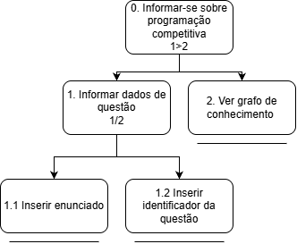
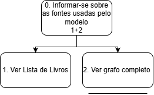

# Entrega 5 — Análise de tarefas: HTA, GOMS e CTT

**Data:** {{25/10/2026}}  
**Status:** 🟩 finalizada  
**Responsabilidade:** cada integrante modela pelo menos 1 HTA, 1 GOMS e 1 CTT. As três técnicas podem abordar a mesma funcionalidade ou funcionalidades distintas, conforme a orientação da disciplina.

## Objetivo da atividade

Modelar tarefas importantes sob perspectivas complementares: decomposição hierárquica (HTA), estrutura de metas/métodos/operações (GOMS) e relações temporais entre tarefas (CTT). O diagrama deve ser acompanhado de interpretação textual.

## Para projetos cujo TCC não previa interface

Modele **tarefas humanas relacionadas ao uso da contribuição técnica**, e não a implementação interna do algoritmo. Exemplos de boas tarefas para análise:

- investigar uma consulta de baixo desempenho;
- configurar uma análise e selecionar parâmetros;
- submeter um dataset e verificar sua validade;
- acompanhar uma execução demorada;
- comparar dois resultados/modelos;
- interpretar uma recomendação e decidir se a aceita;
- localizar uma execução anterior usando busca/filtros;
- gerar e compartilhar um relatório;
- administrar papéis/permissões quando isso for parte do trabalho real;
- revisar um alerta e registrar uma decisão.

Um CRUD pode gerar tarefas relevantes, mas “cadastrar usuário” só merece modelagem se tiver significado no domínio (papéis, validações, riscos, permissões, dependências).

## Seleção das tarefas

| ID | Tarefa | Persona/cenário de origem | Frequência/criticidade | Autor responsável |
|---|---|---|---|---|
| T01 | Informar-se sobre programação competitiva  | C01 e P01 | Uso mais frequente e crítico da aplicação | Sebastian Citta |
| T02 | Informar-se sobre fontes utilizadas no modelo  | C02 e P02 | Frequência baixa e criticidade média | Juan Manuel Citta |

> Priorize tarefas necessárias para que o usuário alcance objetivos centrais. Não desperdice a modelagem em ações triviais isoladas, como “clicar em login”, se o objetivo relevante é maior. Da mesma forma, não modele o funcionamento interno do algoritmo como se fosse uma tarefa humana.

---

## HTA — T01 Informar-se sobre programação competitiva

**Autor(a):** Sebastian Citta - 24.123.068-9

### Descrição da tarefa

O objetivo da tarefa é sanar as dúvidas sobre programação competitiva do usuário. 
O ponto de início é o usuário entrar com o enunciado ou o identificador da questão no campo de texto.
A conclusão esperada é uma trilha de aprendizado em formato de grafo.
A tarefa ocorre dentro da página principal da aplicação.

### Diagrama

### Decomposição e planos

| ID | Objetivo/operação | Plano/ordem | Problema ou decisão de design observada |
|---|---|---|---|
| 0 | Informar-se sobre programação competitiva | 1 > 2 | Input: Caixa de texto com mensagem para inserir o enunciado ou identificador da questão no site CodeForces. Feedback: Trilha de aprendizado em formato de grafo. Plano: Informar questão e depois mostrar a trilha. Recomendação: exibir indicador de carregamento enquanto o grafo é gerado. |
| 1 | Informar dados de questão | 1 / 2 | Decisão: oferecer duas formas alternativas de entrada (enunciado ou identificador), já que nem sempre o usuário tem o enunciado completo à mão. O usuário escolhe apenas uma. |
| 1.1 | Inserir enunciado | — | Problema: enunciados longos são trabalhosos de digitar. Recomendação: usar campo de texto multilinha que facilite colar o texto. |
| 1.2 | Inserir identificador da questão | — | Problema: o usuário pode não saber o formato esperado do identificador. Recomendação: incluir exemplo (placeholder) e validar o formato. |
| 2 | Ver grafo de conhecimento | — | Decisão: a trilha de aprendizado é apresentada como grafo. Problema: grafos grandes podem ser difíceis de navegar. Recomendação: destacar o caminho recomendado e permitir zoom. |

## HTA — T02 Informar-se sobre fontes utilizadas no modelo

**Autor(a):** Juan Manuel Citta - 24.123.022-6

### Descrição da tarefa
O objetivo da tarefa é permitir que o usuário conheça as fontes utilizadas pelo modelo.
O ponto de início é o usuário acessar a seção de fontes a partir da aplicação.
A conclusão esperada é o usuário ter visto a lista de livros e o grafo completo de conhecimento.

### Diagrama

### Decomposição e planos

| ID | Objetivo/operação | Plano/ordem | Problema ou decisão de design observada |
|---|---|---|---|
| 0 | Informar-se sobre as fontes usadas pelo modelo | 1 + 2 | Input: o usuário acessa a seção de fontes a partir da página principal da aplicação. Feedback: lista de livros e grafo completo de conhecimento exibidos na tela. Plano: ver a lista de livros e ver o grafo completo, em qualquer ordem. Recomendação: deixar claro, na navegação, que as duas visualizações estão disponíveis. |
| 1 | Ver lista de livros | — | Decisão: apresentar as fontes como lista, para o usuário saber quais livros alimentam o modelo. Problema: uma lista longa pode ser difícil de percorrer. Recomendação: incluir busca ou ordenação por título e autor. |
| 2 | Ver grafo completo | — | Decisão: mostrar o grafo completo, e não só a trilha da questão, para o usuário entender como os conceitos se relacionam. Problema: grafos grandes são difíceis de navegar e de ler. Recomendação: permitir zoom, filtro por tópico e destaque ao selecionar um nó. |

**Verificação do HTA:**

- O objetivo 0 representa uma meta do usuário?
- As subtarefas são necessárias e suficientes?
- Os **planos** indicam ordem, alternativa, repetição ou condição?
- A decomposição parou em nível útil para projeto de interação?

---

## GOMS — T01 Informar-se sobre programação competitiva

**Autor(a):** Sebastian Citta - 24.123.068-9

### Goal

GOAL 0: sanar dúvidas sobre programação competitiva obtendo uma trilha de aprendizado em grafo

### Métodos, operadores e regras de seleção

GOAL 1: informar a questão à aplicação

METHOD 1.A: informar a questão pelo enunciado (SEL. RULE: o usuário tem o enunciado em mãos e não lembra o identificador da questão)
- OP. 1.A.1: copiar o enunciado da questão no site CodeForces
- OP. 1.A.2: deslocar o cursor do mouse para o campo de texto da página principal
- OP. 1.A.3: clicar com o botão esquerdo do mouse no campo de texto
- OP. 1.A.4: colar o enunciado no campo de texto
- OP. 1.A.5: verificar se o enunciado foi inserido por completo
- OP. 1.A.6: pressionar a tecla Enter (ou clicar no botão de envio)

METHOD 1.B: informar a questão pelo identificador (SEL. RULE: o usuário sabe o identificador da questão, o que é mais rápido que copiar um enunciado longo)
- OP. 1.B.1: localizar o identificador da questão no site CodeForces
- OP. 1.B.2: deslocar o cursor do mouse para o campo de texto da página principal
- OP. 1.B.3: clicar com o botão esquerdo do mouse no campo de texto
- OP. 1.B.4: digitar o identificador da questão
- OP. 1.B.5: verificar se o identificador está correto
- OP. 1.B.6: pressionar a tecla Enter (ou clicar no botão de envio)

GOAL 2: visualizar o grafo de conhecimento

METHOD 2.A: ver a trilha de aprendizado (SEL. RULE: sempre executado após o GOAL 1, pois a trilha só é exibida depois que a questão é informada)
- OP. 2.A.1: aguardar a geração do grafo
- OP. 2.A.2: perceber o grafo exibido na tela
- OP. 2.A.3: ler os conceitos e a ordem sugerida de estudo

---

## GOMS — T02 Informar-se sobre fontes utilizadas no modelo

**Autor(a):** Juan Manuel Citta - 24.123.022-6

### Goal

GOAL 0: conhecer as fontes utilizadas pelo modelo para gerar as trilhas de aprendizado

### Métodos, operadores e regras de seleção

GOAL 1: ver a lista de livros

METHOD 1.A: ver a lista de livros pela opção de fontes (SEL. RULE: o usuário quer saber quais livros alimentam o modelo)
- OP. 1.A.1: deslocar o cursor do mouse para a opção de fontes da aplicação
- OP. 1.A.2: clicar com o botão esquerdo do mouse na opção "Lista de livros"
- OP. 1.A.3: perceber a lista de livros exibida na tela
- OP. 1.A.4: ler os títulos para identificar as fontes do modelo

GOAL 2: ver o grafo completo

METHOD 2.A: ver o grafo completo pela opção de fontes (SEL. RULE: o usuário quer entender como os conceitos se relacionam)
- OP. 2.A.1: deslocar o cursor do mouse para a opção de fontes da aplicação
- OP. 2.A.2: clicar com o botão esquerdo do mouse na opção "Grafo completo"
- OP. 2.A.3: aguardar o carregamento do grafo
- OP. 2.A.4: perceber o grafo completo exibido na tela
- OP. 2.A.5: explorar os conceitos e suas relações

## CTT — T01 Informar-se sobre programação competitiva

**Autor(a):** Sebastian Citta - 24.123.068-9

### Descrição

A tarefa abstrata raiz (0) se decompõe em duas subtarefas abstratas: informar a questão (1) e ver o grafo de conhecimento (2). A tarefa 1 só habilita a 2 depois de concluída, e passa a ela a questão informada (`[]>>`).

Informar a questão (1) se divide em informar os dados (1.1) e enviar a questão (1.2). Em 1.1 o usuário escolhe uma entre duas alternativas (`[]`):
- **1.1.1 Informar enunciado:** copiar o enunciado no CodeForces (tarefa de usuário) e colá-lo no campo de texto (tarefa de interação).
- **1.1.2 Informar identificador:** localizar o identificador no CodeForces (tarefa de usuário) e digitá-lo no campo de texto (tarefa de interação).

Em ver o grafo de conhecimento (2), o sistema gera a trilha de aprendizado (2.1) e a exibe (2.2), e o usuário lê os conceitos e a ordem de estudo (2.3).

### Diagrama

### Legenda e relações temporais usadas

| Operador/relação | Significado no diagrama | Exemplo no modelo |
|---|---|---|
| Tarefa abstrata (nuvem) | Composição de tarefas, que não é uma tarefa em si e serve para decompor | Informar-se sobre programação competitiva; Informar questão |
| Tarefa de interação (computador e pessoa) | Diálogo entre usuário e sistema | Inserir enunciado; Inserir identificador da questão |
| Tarefa de sistema (computador) | Processamento feito pelo sistema, sem interagir com o usuário | Exibir grafo de conhecimento (a aplicação gera e mostra a trilha) |
| `[]` (escolha) | Duas tarefas habilitadas, mas ao iniciar uma a outra é desabilitada | Inserir enunciado `[]` Inserir identificador da questão |
| `[]>>` (habilitação com passagem de informação) | A segunda só começa após a primeira terminar, recebendo a informação produzida | Informar questão `[]>>` Exibir grafo de conhecimento |

Concorrência (`|||`), desativação (`[>`), suspensão/retomada (`|>`) e repetição (`*`) não foram usadas, pois o HTA e o GOMS descrevem um fluxo sequencial com uma única escolha. Se a aplicação permitir consultar várias questões em sequência, a tarefa 0 pode receber o `*` de repetição.

---

## CTT — T02 Informar-se sobre fontes utilizadas no modelo

**Autor(a):** Juan Manuel Citta - 24.123.022-6

### Descrição

A tarefa abstrata raiz (0) é composta por duas subtarefas abstratas: ver a lista de livros (1) e ver o grafo completo (2). Como no HTA o plano é "1 + 2" (qualquer ordem), elas se relacionam por independência (`|=|`): o usuário pode começar por qualquer uma, mas precisa terminar uma antes de iniciar a outra.

As duas seguem o mesmo padrão de decomposição:
- **Ver lista de livros (1):** o usuário seleciona a opção "Lista de livros" (interação), o sistema exibe a lista (sistema) e o usuário lê os títulos das fontes (usuário).
- **Ver grafo completo (2):** o usuário seleciona a opção "Grafo completo" (interação), o sistema carrega e exibe o grafo (sistema) e o usuário explora os conceitos e suas relações (usuário).

### Diagrama

### Legenda e relações temporais usadas

| Operador/relação | Significado no diagrama | Exemplo no modelo |
|---|---|---|
| Tarefa abstrata (nuvem) | Composição de tarefas, que não é uma tarefa em si e serve para decompor | Informar-se sobre fontes usadas pelo modelo |
| Tarefa de interação (computador e pessoa) | Diálogo entre usuário e sistema | Ver lista de livros; Ver grafo completo |
| `\|=\|` (independência) | Qualquer ordem, mas uma tarefa iniciada precisa terminar antes de a outra começar | Ver lista de livros `\|=\|` Ver grafo completo |
## Síntese da equipe

**Problemas de interação identificados:**
- Em T01, enunciados longos são trabalhosos de digitar. O campo precisa facilitar a colagem, e o formato do identificador precisa ficar claro para o usuário.
- A geração do grafo (T01, 2.1) não tem feedback visível no modelo, e o usuário pode achar que a aplicação travou.
- Os grafos (T01 e T02) podem ficar grandes e difíceis de ler e navegar.
- Em T02, uma lista longa de livros é difícil de percorrer sem busca ou ordenação.

**Oportunidades e requisitos:**
- Aceitar enunciado e identificador no mesmo campo de texto, com placeholder de exemplo e validação de formato.
- Mostrar indicador de carregamento enquanto o grafo é gerado.
- Oferecer zoom, filtro por tópico e destaque do caminho recomendado nos grafos.
- Oferecer busca e ordenação por título e autor na lista de livros.
- Deixar clara na navegação a existência das duas visualizações das fontes (lista e grafo).

**Protótipo e teste de usabilidade:**
- **T01** vai para o protótipo e para o teste, por ser o uso mais frequente e crítico da aplicação. O teste deve cobrir as duas formas de entrada (enunciado e identificador) e a leitura do grafo.
- **T02** vai para o protótipo, por ser parte do mesmo fluxo de navegação. No teste entra como tarefa curta de verificação (o usuário encontra a lista de livros e o grafo completo), já que a frequência é baixa e a criticidade média.

## Checklist

- [x] Cada integrante produziu ao menos 1 HTA, 1 GOMS e 1 CTT.
- [x] Cada artefato identifica autor e tarefa.
- [x] Diagramas são legíveis e possuem fonte editável quando possível.
- [x] HTA contém planos, não apenas árvore de tópicos.
- [x] GOMS distingue Goals, Operators, Methods e Selection Rules.
- [x] CTT usa operadores temporais e tipos de tarefa coerentes.
- [x] Há texto explicando cada diagrama.
- [x] Tarefas estão ligadas a cenários/personas na rastreabilidade.
- [] Em TCC técnico, as tarefas descrevem o que a pessoa faz com a contribuição/resultados, não passos internos do código.
- [] CRUDs, relatórios, filtros e atividades administrativas foram escolhidos por relevância ao objetivo do usuário.
