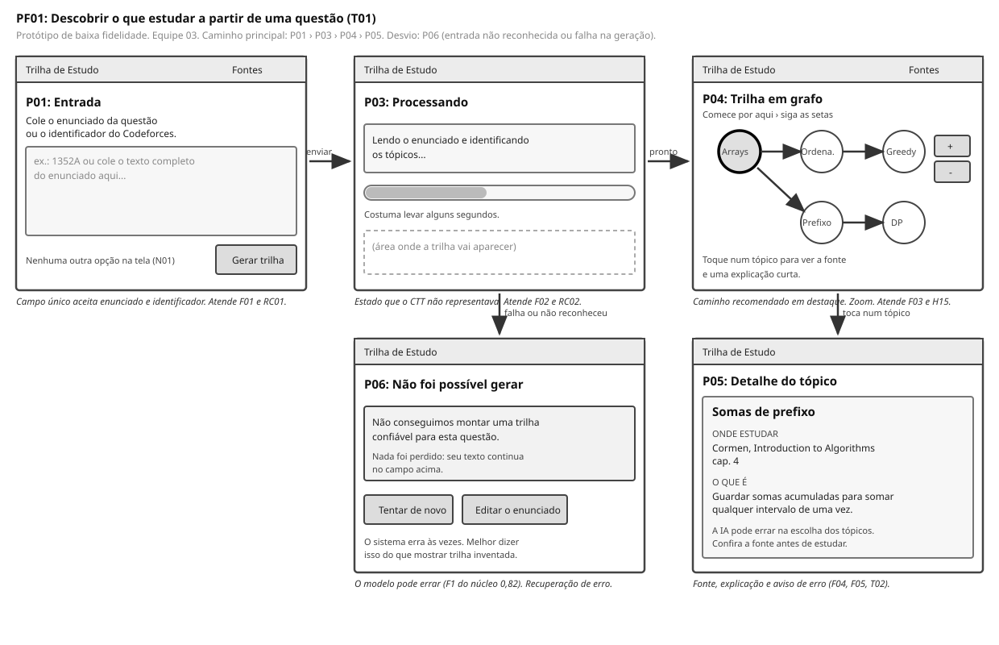

# Entrega 6 — Prototipação em papel

**Data:** 09/11/2026
**Status:** 🟨 em andamento — telas prontas, walkthrough ainda não realizado
**Responsabilidade:** 1 solução integrada por equipe

## Objetivo da atividade

Externalizar rapidamente ideias de interação em baixa fidelidade para explorar alternativas antes de investir em detalhes visuais. O valor da atividade está no **ciclo construir → simular → observar → revisar**, não na beleza do desenho.

## 1. Escopo do protótipo

**Personas:** P01 (Alfreda Marta, primária) e P02 (José Carlos Trunchado, secundária). P02 é atendida pela mesma interface, sem login nem tela exclusiva, conforme o critério registrado na Entrega 3.

**Cenários/tarefas cobertos:** C01 e T01 (principal); C02 e T02 (verificação curta, no mesmo fluxo de navegação).

**Objetivos principais:** são objetivos do usuário que este protótipo apoia, não objetivos da simulação.

| # | Objetivo do usuário | Origem |
|---|---|---|
| 1 | Descobrir, a partir de uma questão em que travou, quais tópicos estudar e em que ordem | A01 (Entrega 1, 7.3); ações F01 a F03 (Entrega 1, 9.2) |
| 2 | Chegar à fonte pedagógica de cada tópico e avaliar o quanto confiar nela | Ações F04 e F05 (Entrega 1, 9.2) |
| 3 | Conferir de quais livros o modelo tira os tópicos | T02 (Entrega 5) |

## 1.1 Possíveis famílias de interface

Escolha apenas o que for coerente com tarefas e cenários. Para TCCs técnicos, o protótipo pode explorar:

- **dashboard** para monitoramento e tomada de decisão;
- **configuração/parametrização** para preparar algoritmo/modelo/processo;
- **entrada/seleção de dados** com validação;
- **acompanhamento de execução** com progresso, fila, cancelamento e recuperação;
- **relatório/resultados** com explicação, gráficos e exportação;
- **histórico** com busca, filtros, ordenação e detalhes;
- **comparação** entre execuções, versões, algoritmos ou períodos;
- **administração** de usuários, papéis, permissões ou entidades do domínio;
- **auditoria/logs** traduzidos para o perfil;
- **alertas/ocorrências** com ação de resposta.

> Não desenhe todas essas telas por obrigação. O objetivo da baixa fidelidade é experimentar a **estrutura da interação** necessária para as tarefas priorizadas.

**Famílias usadas neste protótipo:** entrada de dados com validação (P01, P02), acompanhamento de execução (P03), relatório de resultados (P04, P05), recuperação de erro (P06) e consulta a fontes (P07, P08). Dashboard, histórico, comparação, administração e auditoria ficaram de fora porque nenhuma tarefa de T01 ou T02 os exige.

## 2. Fluxos escolhidos

| Fluxo | Tarefa/objetivo | Por que foi priorizado |
|---|---|---|
| PF01 | T01, descobrir o que estudar a partir de uma questão | É o uso mais frequente e mais crítico da aplicação (Entrega 5). Concentra a espera pelo modelo, a leitura do grafo e o julgamento de confiança, que são os três pontos de risco do projeto |
| PF02 | T02, conferir as fontes usadas pelo modelo | Entra porque ocorre na mesma interface e no mesmo fluxo de navegação. Serve tanto a P02 (confiar antes de repassar) quanto a P01 (saber onde estudar) |

## 3. Telas e estados

- Numere as telas/estados (`P01`, `P02`...).
- Indique controles que mudam o estado.
- Mostre pelo menos caminhos principais e estados de erro/retorno relevantes.

### PF01 — fluxo principal

| Tela | Estado | Controle que muda o estado | Por que existe |
|---|---|---|---|
| P01 | Entrada vazia | Campo de texto e botão Gerar trilha | A aluna chega travada e sem repertório para configurar nada. Uma só ação possível (N01, RC01, F01) |
| P02 | Pedido de esclarecimento | O botão continua ativo; o texto permanece no campo | O formato do identificador não é óbvio (Entrega 5). Como o recorte de 7.4 define entrada conversacional, o sistema responde em vez de bloquear: pergunta de volta e deixa o usuário corrigir |
| P03 | Processando | Automático após enviar | A inferência demora. Sem retorno, a espera é lida como travamento (F02, RC02) |
| P04 | Trilha em grafo | Zoom e toque num tópico | Mostra ordem e dependência, que é o que as tags do juiz online não dão (F03, H15) |
| P05 | Detalhe do tópico | Toque num nó; voltar | Reúne onde estudar, por que o tópico apareceu e o quanto o sistema está confiante (F04, F05) |
| P06 | Falha na geração | Tentar de novo ou editar | O modelo erra com frequência medida e já alucinou. Melhor admitir do que exibir trilha inventada |

### PF02 — fontes

| Tela | Estado | Controle que muda o estado | Por que existe |
|---|---|---|---|
| P07 | Lista de livros | Busca, e botão Ver grafo | Uma lista longa é difícil de percorrer sem busca (Entrega 5) |
| P08 | Grafo completo | Filtro por tópico, e botão Ver lista | É o que P02 consegue conferir. A ferramenta não mostra as consultas dos alunos (decisão de escopo da Entrega 9) |

**Caminhos representados:** principal (P01 › P03 › P04 › P05), esclarecimento de entrada (P01 › P02 › P01), falha do modelo (P03 › P06), navegação entre as duas visões de fontes (P07 ⇄ P08).

## 4. Simulação / walkthrough

Realize uma simulação com uma pessoa que não participou da elaboração dessas telas. Um colega pode ser usado **para essa iteração formativa**, mas isso não substitui os participantes finais da Entrega 14.

### 4.1 Protocolo

**Tarefas a pedir, nestas palavras:**

1. *"Você travou numa questão do Codeforces e quer descobrir o que precisa estudar para conseguir resolvê-la sozinho. Mostre o que você faria."* (T01)
2. *"Agora você quer saber de qual livro o sistema tirou o tópico 'Somas de prefixo'. Mostre como faria."* (T01, F04)
3. *"Imagine que você é o professor dessa turma e quer conferir de quais livros a ferramenta tira os tópicos antes de indicá-la aos alunos. Mostre como faria."* (T02)

**O que registrar em cada tarefa:** onde a pessoa tocou primeiro, onde hesitou, o que perguntou espontaneamente, que rótulo ela não entendeu, se chegou ao objetivo e em quanto tempo.

### 4.2 Registro das observações

> A preencher depois da sessão.

| Observação | Tela/ação | Evidência | Consequência para o design |
|---|---|---|---|
| | | | |

## 5. Alterações após a simulação

> A preencher depois da sessão.

| Antes | Problema | Depois | Justificativa |
|---|---|---|---|
| | | | |

## Checklist

- [X] O protótipo cobre tarefas relevantes da Entrega 5. *(T01 em PF01 e T02 em PF02)*
- [X] Cada tela/estado pode ser justificado por uma tarefa, decisão ou informação necessária. *(coluna "Por que existe" nas tabelas da seção 3)*
- [X] O projeto não criou dashboard/CRUD/login apenas para parecer “completo”. *(famílias descartadas e o motivo estão na seção 1.1)*
- [X] Telas/estados estão numerados e navegáveis na documentação. *(P01 a P08, com os caminhos listados ao fim da seção 3)*
- [ ] Há pelo menos uma simulação/walkthrough documentado. — **pendente: o protocolo está pronto na seção 4.1, a sessão ainda não foi realizada**
- [ ] Críticas não foram apenas listadas: geraram decisão de revisão. — **pendente, depende da sessão**
- [X] O protótipo continua em baixa fidelidade; detalhes visuais não mascaram problemas de fluxo. *(sem cor, sem tipografia de marca, caixas e traços simples)*
