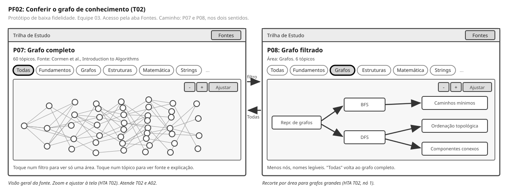

# Entrega 6 — Prototipação em papel

**Data:** 09/11/2026; concluída em 11/11/2026
**Status:** 🟩 concluída  
**Responsabilidade:** 1 solução integrada por equipe

## Objetivo da atividade

Externalizar rapidamente ideias de interação em baixa fidelidade para explorar alternativas antes de investir em detalhes visuais. O valor da atividade está no **ciclo construir → simular → observar → revisar**, não na beleza do desenho.

## 1. Escopo do protótipo

**Personas:** P01 (Alfreda Marta, primária) e P02 (José Carlos Trunchado, secundária). P02 é atendida pela mesma interface, sem login nem tela exclusiva, conforme o critério registrado na Entrega 3.

**Cenários/tarefas cobertos:** C01 e T01 (principal); C02 e T02 (verificação curta, no mesmo fluxo de navegação).

**Objetivos principais:** são objetivos do usuário que este protótipo apoia, não objetivos da simulação.

| # | Objetivo do usuário | Origem |
|---|---|---|
| 1 | Descobrir, a partir de uma questão em que travou, quais tópicos estudar e em que ordem | A01 (Entrega 1, 7.3); ações F01 a F03 (Entrega 1, 9.2) |
| 2 | Visualizar a estrutura do grafo de conhecimento da aplicação  | Ações A02 (Entrega 1) e F05 (Entrega 1, 9.2) |

## 1.1 Possíveis famílias de interface

Escolha apenas o que for coerente com tarefas e cenários. Para TCCs técnicos, o protótipo pode explorar:

- **dashboard** para monitoramento e tomada de decisão;
- **configuração/parametrização** para preparar algoritmo/modelo/processo;
- **entrada/seleção de dados** com validação;
- **acompanhamento de execução** com progresso, fila, cancelamento e recuperação;
- **relatório/resultados** com explicação, gráficos e exportação;
- **histórico** com busca, filtros, ordenação e detalhes;
- **comparação** entre execuções, versões, algoritmos ou períodos;
- **administração** de usuários, papéis, permissões ou entidades do domínio;
- **auditoria/logs** traduzidos para o perfil;
- **alertas/ocorrências** com ação de resposta.

> Não desenhe todas essas telas por obrigação. O objetivo da baixa fidelidade é experimentar a **estrutura da interação** necessária para as tarefas priorizadas.

**Famílias usadas neste protótipo:** entrada de dados com validação (P01), acompanhamento de execução (P03), relatório de resultados (P04, P05), recuperação de erro (P06) e consulta a fontes (P07, P08). Dashboard, histórico, comparação, administração e auditoria ficaram de fora porque nenhuma tarefa de T01 ou T02 os exige.

## 2. Fluxos escolhidos

| Fluxo | Tarefa/objetivo | Por que foi priorizado |
|---|---|---|
| PF01 | T01, descobrir o que estudar a partir de uma questão | É o uso mais frequente e mais crítico da aplicação (Entrega 5). Concentra a espera pelo modelo, a leitura do grafo e o julgamento de confiança, que são os três pontos de risco do projeto |
| PF02 | T02, conferir o grafo de conhecimento da aplicação | Porque é uma tarefa base que serve tanto a P02 (verificar antes de repassar) quanto a P01 (saber onde estudar, conhecer os tópicos da modalidade). |

## 3. Telas e estados

- Numere as telas/estados (`P01`, `P02`...).
- Indique controles que mudam o estado.
- Mostre pelo menos caminhos principais e estados de erro/retorno relevantes.

### PF01 — fluxo principal

| Tela | Estado | Controle que muda o estado | Por que existe |
|---|---|---|---|
| P01 | Entrada vazia | Campo de texto e botão de submissão | É a forma de acessar a funcionalidade de T01, uma única entrada e fácil de entender, seguindo os padrões de outros modelos comerciais. (N01, RC01, F01) |
| P03 | Processando | Automático após enviar | A inferência demorou até 6.2s em testes (medido no TCC). Sem retorno, a espera pode ser lida como travamento (F02, RC02) |
| P04 | Trilha em grafo | Clique num tópico ou nova requisição | Mostra ordem e dependência dos tópicos cobrados no enunciado (F03, H15) |
| P05 | Detalhe do tópico | Clique num nó; voltar | Abre um painel ao lado do grafo com os detalhes (capítulo e explicação curta) do tópico |
| P06 | Falha na geração | Entrar com nova requisição | A entrada pode não ser processada pelo modelo e dar erro. A tela explica que não foi possível gerar a trilha e permite tentar de novo. |

### PF02 — fontes

| Tela | Estado | Controle que muda o estado | Por que existe |
|---|---|---|---|
| P07 | Grafo completo | Filtro por tópico | É a funcionalidade que atende a T02 e A02. Serve para o usuário poder ver o grafo de conhecimento utilizado na aplicação. |
| P08 | Grafo Filtrado | Botão "Todos" | Facilita para a visualização de segmentos do grafo inteiro |

**Caminhos representados:** principal (P01 › P03 › P04 › P05), entrada não reconhecida ou falha do modelo (P03 › P06), navegação entre as duas visões de fontes (P07 ⇄ P08).

## 4. Simulação / walkthrough

Realize uma simulação com uma pessoa que não participou da elaboração dessas telas. Um colega pode ser usado **para essa iteração formativa**, mas isso não substitui os participantes finais da Entrega 14.

A pessoa escolhida foi um amigo de um dos integrantes, estudante de Sistemas. Ele não tem muita experiência com programação competitiva e apenas conhece a plataforma Leetcode, muito usada para entrevistas. A pessoa se encaixa como um iniciante na programação competitiva. O walkthrough ocorreu em 11/11/2026 por via remota.

O grupo decidiu não procurar uma pessoa com mais experiência pela natureza da solução, que pretende focar em ajudar os iniciantes. 

### 4.1 Protocolo

**Tarefas a pedir, nestas palavras:**

1. *"Você travou numa questão do Codeforces e quer descobrir o que precisa estudar para conseguir resolvê-la sozinho. Mostre o que você faria."* (T01)
2. *"Agora você quer saber em qual capítulo estudar algum dos tópicos devolvidos"* (T01, F04)
3. *"Imagine que você é o professor dessa turma e quer conferir o grafo de conhecimento utilizado na aplicação. Como você faria?"* (T02)

**O que registrar em cada tarefa:** onde a pessoa tocou primeiro, onde hesitou, o que perguntou espontaneamente, que rótulo ela não entendeu, se chegou ao objetivo e em quanto tempo.

### 4.2 Registro das observações

| Observação | Tela/ação | Evidência | Consequência para o design |
|---|---|---|---|
| Já entrou na aplicação com o enunciado da questão colado | P01 | Observado pela equipe |  - |
| Navegou pelos menús sem demora | Todas as telas | Observado pela equipe |  - |
| Uma trilha de aprendizado ficou grande e abriu uma barra de rolagem. O participante a utilizou sem precisar de mais dicas. | P04 | Observado pela equipe |  - |
| O participante soube sem indicação de que podia interagir com os tópicos do grafo. | P04 | Observado pela equipe |  - |

## 5. Alterações após a simulação

| Antes | Problema | Depois | Justificativa |
|---|---|---|---|
| | | | |

A equipe não encontrou problemas na utilização da aplicação. Talvez sejam necessários mais participantes para notar alguma dificuldade no uso.

## Checklist

- [X] O protótipo cobre tarefas relevantes da Entrega 5. *(T01 em PF01 e T02 em PF02)*
- [X] Cada tela/estado pode ser justificado por uma tarefa, decisão ou informação necessária. *(coluna "Por que existe" nas tabelas da seção 3)*
- [X] O projeto não criou dashboard/CRUD/login apenas para parecer “completo”. *(famílias descartadas e o motivo estão na seção 1.1)*
- [X] Telas/estados estão numerados e navegáveis na documentação. *(P01 a P08, com os caminhos listados ao fim da seção 3)*
- [X] Há pelo menos uma simulação/walkthrough documentado. 
- [X] Críticas não foram apenas listadas: geraram decisão de revisão.  
- [X] O protótipo continua em baixa fidelidade; detalhes visuais não mascaram problemas de fluxo. *(sem cor, sem tipografia de marca, caixas e traços simples)*
