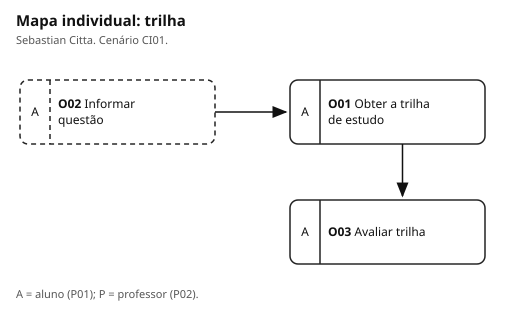
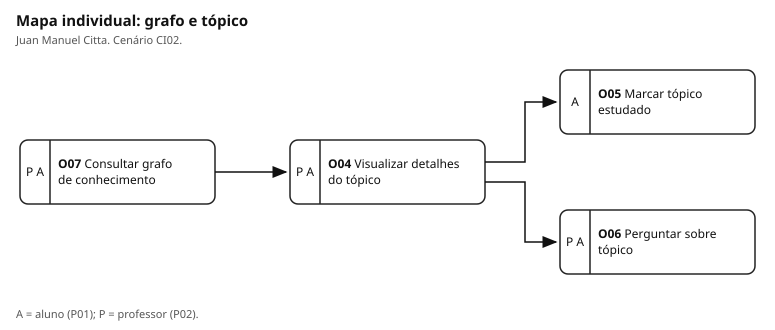
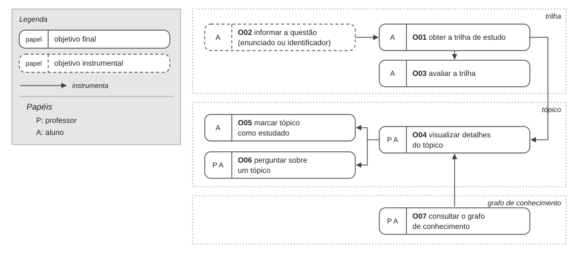

# Entrega 9: Modelo conceitual e design centrado na comunicação

**Data:** 31/10/2026  
**Status:** 🟩 concluída  
**Responsabilidade:** soluções individuais, com consolidação da equipe para mapa de objetivos e esquema de signos.

## Objetivo da atividade

Passar do cenário de problema para uma concepção da interação, explicitando objetivos, tópicos de conversa, falas e signos que a interface deverá comunicar/manipular.

## Transformando resultados técnicos em conceitos compreensíveis

Em TCCs algorítmicos ou orientados a dados, esta entrega deve evitar que a interface exponha apenas estruturas internas do código. Identifique os **conceitos e signos que fazem sentido para o usuário**.

Exemplos:

- `query plan`, custo estimado, recomendação e impacto para um DBA;
- modelo, dataset, versão, execução e métrica para engenheiro de IA;
- período, indicador, grupo, tendência e filtro para gestor/analista;
- alerta, severidade, evidência, responsável e status para analista de segurança.

Se um termo técnico for necessário, modele como será comunicado, explicado e relacionado à tarefa.

Dashboards, relatórios, filtros e CRUDs devem aparecer no modelo conceitual por meio dos **objetivos, signos e conversas** que justificam sua existência.

## 1. Cenários de interação

Para cada cenário de problema, produza uma versão em que a solução já pode ser descrita. **Destaque claramente o texto alterado** em relação ao cenário original.

### CI01: Descobrir o que estudar para resolver uma questão

**Autor(a):** Sebastian Citta, 24.123.068-9  
**Origem:** cenário problema C01

Alfreda está no 3º semestre de Ciência da Computação e treina programação competitiva sozinha, no notebook, em casa. Ela programa com segurança e resolve sem ajuda as questões mais fáceis do Codeforces, mas ainda não sabe identificar, pelo enunciado, qual técnica uma questão exige. Hoje ela abriu um problema novo, com o enunciado em uma aba e o editor de código em outra, e o leu várias vezes. Escreveu uma primeira tentativa e submeteu, mas o veredito foi Wrong Answer. Ela entende o veredito, mas isso não a ajuda a saber o que fazer.

Alfreda já viu as palavras dp, greedy e constructive algorithms nas etiquetas de problemas. Algumas ela reconhece de disciplinas do curso, mas não consegue dizer qual delas se aplica à questão, nem o que precisaria estudar antes. **[ALTERADO] Depois de mais algumas submissões erradas, em vez de tentar por eliminação ou colar o enunciado em um LLM que lhe entregaria a solução, ela abre a ferramenta de trilhas e informa a questão: cola o enunciado inteiro ou, como a questão é do Codeforces, informa só o identificador. A ferramenta mostra que está montando a trilha e, em poucos segundos, apresenta os tópicos que ela precisa estudar e a ordem entre eles: o que precisa saber antes e o que vem depois.**

**[NOVO] Cada tópico traz uma explicação curta em português e o capítulo do Cormen onde é tratado. Alfreda encontra "dynamic programming" na trilha e, pela explicação, entende que é programação dinâmica e que, antes dela, a trilha indica recursão. Um dos tópicos é básico e não tem capítulo no livro; a ferramenta deixa isso claro, e ela não perde tempo procurando no índice. Junto da trilha fica o aviso padrão de que a IA pode cometer erros.**

No meio disso, uma mensagem a interrompe, e ao voltar **[ALTERADO] a trilha continua aberta, e ela retoma do tópico em que tinha parado, sem precisar reler o enunciado para lembrar o que ia estudar.**

Alfreda não quer a solução pronta, porque o objetivo é evoluir no treino. **[ALTERADO] A ferramenta não mostra a solução nem o código: mostra só o que estudar e onde. Alfreda abre o capítulo indicado, estuda o tópico por onde a trilha começa e, quando consegue dizer com as próprias palavras por que a questão pede programação dinâmica, volta a ela e tenta de novo por conta própria.**

**[NOVO] Durante o estudo, surge uma dúvida sobre recursão, e Alfreda pergunta sobre o tópico na própria ferramenta. A resposta explica o tópico com trechos do Cormen, sem resolver a questão. Ao terminar, ela marca o tópico como estudado, para saber onde parou, e indica pelo botão que a trilha ajudou.**

### Diferenças relevantes

| Alteração | Por que foi necessária | Evidência/artefato que justifica |
|---|---|---|
| Alfreda informa a questão pelo enunciado ou pelo identificador | No C01 ela não tinha como descobrir o que estudar a partir da questão | Entrega 5, T01 (1.1 e 1.2); F01 |
| A ferramenta mostra que está montando a trilha | Sem retorno, ela não distingue "processando" de "travou" | F02; Entrega 8, tempo de processamento |
| A trilha mostra os tópicos e a ordem entre eles | No C01 as etiquetas davam o nome do assunto, mas não a ordem nem os pré-requisitos | N02, F03; lacuna declarada na implementação do TCC |
| Cada tópico tem explicação curta em português | Ela não associava `dp` a um conteúdo que soubesse estudar | N05, H05 |
| Cada tópico indica o capítulo do Cormen, ou que não tem capítulo | No C01 ela não sabia nem o nome do que procurar | N03, F04, H25 |
| A trilha vem com o aviso padrão de que a IA pode cometer erros | O modelo pode errar na atribuição de tópicos e não devolve grau de confiança por tópico | Entrega 8, restrições da plataforma |
| A trilha continua aberta depois da interrupção | No C01 ela precisava reler enunciado e código após cada interrupção | H23 |
| A ferramenta não entrega a solução | Alfreda quer evoluir no treino, não receber a resposta | H07; C01 `[Q5]` |
| Alfreda pergunta sobre um tópico | A explicação curta pode não bastar, e no C01 a alternativa era um LLM que entrega a solução | O06; H07 |
| Alfreda marca o tópico como estudado | Ela retoma a trilha depois de interrupções e precisa saber onde parou | O05; H23 |
| Alfreda indica se a trilha ajudou | O modelo pode errar, e esse retorno mostra à equipe quais trilhas não serviram | O03; Entrega 8, restrições da plataforma |

### CI02: Conferir as fontes do material antes de recomendá-lo

**Autor(a):** Juan Manuel Citta, 24.123.022-6  
**Origem:** cenário problema C02

> **CI02 é exploratório, como o C02 que lhe dá origem.** Ele parte da proto-persona secundária P02 e depende de H11, que continua aberta. O uso de O04, O06 e O07 por P02 e as metas MU04 e MU05 ficam provisórios e não orientam decisões de interface até H11 ser investigada.

José Carlos leciona em turmas grandes e, nos períodos de preparação para a competição, também treina o time de maratona da faculdade. Ele é especialista: lê o enunciado de uma questão e reconhece na hora a técnica que ela exige. O que lhe falta é tempo. Com poucas horas de aula e muitos alunos, não consegue atender individualmente quem trava, e o plano de treino da maratona acaba sendo montado às pressas.

Quando um aluno trava durante o treino, José Carlos costuma sugerir que ele consulte um dos modelos de IA disponíveis no mercado. Ele sabe que o aluno precisa de alguma ajuda, mas não tem como saber em quais fontes o modelo se baseia, nem se a explicação segue a mesma linha do material que ele já entregou à turma. **[ALTERADO] Antes de recomendar a ferramenta de trilhas ao time, José Carlos decide conferir de onde vem o conteúdo. Ele abre o grafo de conhecimento da ferramenta, que mostra todos os tópicos que podem aparecer nas trilhas e as dependências entre eles, e vê que a fonte usada é o Cormen, livro-texto que ele já conhece e considera confiável.**

**[NOVO] Ele procura no grafo os tópicos que vai trabalhar no próximo treino, como grafos e programação dinâmica. Para cada um, vê o capítulo do Cormen e a explicação curta em português, e confere se a ordem entre os tópicos é a mesma que ele usa em aula. Nos tópicos básicos, que não têm capítulo específico, a ferramenta deixa claro que não há capítulo, e ele entende que não se trata de uma falha. Quando uma explicação curta lhe parece incompleta, ele faz uma pergunta sobre o tópico e confere se a resposta segue o livro.**

José Carlos não quer proibir os alunos de buscar apoio. O incômodo dele não é a IA em si, e sim a falta de controle sobre as fontes. **[ALTERADO] Como confirmou que os tópicos e capítulos seguem um livro que ele aprova, passa a indicar a ferramenta ao time. Ele continua sem ver o que cada aluno consultou, porque a ferramenta não mostra as perguntas dos alunos, mas sabe que as trilhas que eles recebem são montadas a partir dos mesmos tópicos e capítulos que ele conferiu.**

### Diferenças relevantes

| Alteração | Por que foi necessária | Evidência/artefato que justifica |
|---|---|---|
| José Carlos confere a fonte antes de recomendar a ferramenta | No C02 ele não tinha como saber em que fontes a IA se baseava | H24; C02 `[Q7]` e `[Q10]` |
| Ele acessa o grafo de conhecimento com todos os tópicos | Ele não tem acesso às perguntas dos alunos; o que pode verificar é o conjunto de tópicos de onde as trilhas saem | Entrega 5, T02 (2: ver grafo completo) |
| A fonte usada é identificada como o Cormen | Ele confia em livros-texto reconhecidos | C02 `[Q7]`; Entrega 8, delimitação |
| Ele vê capítulo e explicação de cada tópico e a ordem entre eles | Ele precisa comparar com o material que já entregou à turma | Entrega 8, meta qualitativa de P02 e MU04, ambas provisórias (H11) |
| Tópicos sem capítulo são sinalizados | Sem isso, a ausência de capítulo pareceria erro da ferramenta | Comportamento atual do sistema (alguns tópicos não têm capítulo) |
| Ele pergunta sobre um tópico | Precisa conferir se a explicação segue o livro que ele aprova | O06, provisório para P02 (H11) |
| A ferramenta não mostra as perguntas dos alunos | Decisão de escopo: o professor tem acesso apenas ao grafo geral. É essa decisão que mantém P02 como persona secundária, pois ela dispensa interface própria. Incluir histórico por aluno exigiria identificação e controle de acesso, e tornaria P02 primária | Entrega 8, papéis/permissões; Entrega 3, classificação de P02 |

## 2. Design centrado na comunicação

**Nome do cenário:** CI01

| Tópico > subtópico | Falas e signos envolvidos | Intenção/efeito esperado |
|---|---|---|
| obter trilha de estudo para uma questão | `U: Travei nesta questão e não sei o que estudar.` | Iniciar a consulta sem nenhuma configuração prévia (N01) |
| > informar questão | `D: Cole o enunciado da questão ou informe o identificador dela no Codeforces.` / `U: [enunciado]` ou `U: [identificador]` | Aceitar a questão do jeito que o aluno a tem em mãos |
| > informar questão (entrada inválida) | `U: [texto vazio ou que não é um enunciado]` / `D: Isso não parece o enunciado de uma questão. Cole o enunciado completo ou o identificador (por exemplo, 1352A).` | Recuperar a conversa sem perder o que o aluno digitou |
| > acompanhar geração da trilha | `D: Estou montando a trilha para esta questão.` | O aluno sabe que o sistema está trabalhando e não reenvia |
| > acompanhar geração da trilha (falha) | `D: Não consegui montar a trilha agora. Verifique sua conexão e tente novamente em instantes.` | O aluno entende que o problema não é a questão dele |
| > examinar trilha | `D: Para esta questão, estude estes tópicos, nesta ordem: [tópico] → [tópico] → ...` / `U: Por onde começo?` / `D: Comece por [tópico inicial], que não depende de nenhum outro.` | Saber em que ordem estudar (N02) |
| > aviso de erro da IA | `D: Esta trilha foi gerada por IA e pode conter erros.` | Não apresentar a trilha como certa, já que o modelo não devolve confiança por tópico |
| > avaliar trilha | `D: Esta trilha ajudou?` / `U: [sim ou não]` | Dar retorno sobre a trilha com um clique (O03) |
| entender um tópico | `U: O que é [tópico]?` / `D: [explicação curta em português]` | Ligar o termo em inglês a um conteúdo que o aluno sabe estudar (N05) |
| > localizar fonte do tópico | `U: Onde estudo isso?` / `D: No Cormen, capítulo [n]: [título do capítulo].` | Chegar ao material sem saber o nome do assunto (N03) |
| > tópico sem capítulo | `U: Onde estudo [tópico básico]?` / `D: Este é um conceito básico e não tem capítulo específico no livro.` | Evitar que a ausência de capítulo pareça erro |
| > perguntar sobre o tópico | `U: [pergunta sobre o tópico]` / `D: [resposta curta, com os trechos do Cormen usados]` | Tirar a dúvida sobre o tópico sem receber a solução da questão (O06) |
| > marcar tópico estudado | `U: Já estudei este tópico.` / `D: [tópico] marcado como estudado.` | Saber onde parou ao voltar à trilha (O05) |

**Convenção:** `U` = usuário; `D` = preposto do designer/sistema, conforme a abordagem de Engenharia Semiótica adotada na disciplina.

**Nome do cenário:** CI02

| Tópico > subtópico | Falas e signos envolvidos | Intenção/efeito esperado |
|---|---|---|
| conferir as fontes dos tópicos | `U: Quero ver de onde vem o conteúdo que a ferramenta usa.` | Permitir ao professor verificar a fonte antes de recomendar a ferramenta (H24) |
| > conhecer a fonte usada | `D: Todas as trilhas são montadas a partir do Cormen, Introduction to Algorithms.` | Identificar de imediato um livro que o professor reconhece |
| > explorar o grafo de conhecimento | `D: Este é o grafo de conhecimento, com todos os tópicos e as dependências entre eles.` | Mostrar o conjunto de onde as trilhas saem, sem expor perguntas de alunos |
| > localizar tópico | `U: Quero ver [tópico].` / `D: Aqui está [tópico], com os tópicos de que ele depende e os que dependem dele.` | Chegar rápido aos tópicos do próximo treino (MU05, provisória) |
| > localizar tópico (não encontrado) | `U: [termo que não existe no grafo]` / `D: Não encontrei esse tópico. Os tópicos estão em inglês; tente, por exemplo, "graphs".` | Recuperar a busca sem que o professor conclua que o tópico falta |
| > examinar fonte do tópico | `U: De onde vem este tópico?` / `D: Cormen, capítulo [n]: [título do capítulo]. [explicação curta em português]` | Comparar com o material já entregue à turma (MU04, provisória) |
| > tópico sem capítulo | `D: Este é um conceito básico e não tem capítulo específico no livro.` | Evitar que a ausência de capítulo pareça falha da fonte |
| > perguntar sobre o tópico | `U: [pergunta sobre o tópico]` / `D: [resposta curta, com os trechos do Cormen usados]` | Conferir se a explicação segue o livro (O06, provisório para P02) |

**Convenção:** `U` = usuário; `D` = preposto do designer/sistema, conforme a abordagem de Engenharia Semiótica adotada na disciplina.

## 3. Mapa de objetivos

Cada integrante apresenta seu mapa e a equipe cria um **mapa consolidado**, eliminando duplicidades e resolvendo conflitos de nomenclatura.

### Mapas individuais

**Sebastian Citta (CI01):** objetivos relacioandos a trilha.

**Juan Manuel Citta (CI02):** objetivos relacionados ao grafo de conhecimento e ao tópico.

### Mapa consolidado

Os dois mapas se ligam em O04: o detalhe do tópico aberto a partir da trilha (O01) é o mesmo aberto a partir do grafo (O07).

O mapa está dividido em três áreas: trilha (O01 a O03), tópico (O04 a O06) e grafo de conhecimento (O07). Papéis: **A** = aluno (P01); **P** = professor (P02).

### Dicionário de objetivos

| ID | Objetivo | Persona(s) | Cenário(s) | Prioridade |
|---|---|---|---|---|
| O01 | Obter a trilha de estudo | P01 | CI01 | alta |
| O02 | Informar a questão (enunciado ou identificador) | P01 | CI01 | alta |
| O03 | Avaliar a trilha (dizer, pelo botão, se ela ajudou) | P01 | CI01 | média |
| O04 | Visualizar detalhes do tópico (capítulo do livro e explicação curta) | P01, P02 | CI01, CI02 | alta |
| O05 | Marcar tópico como estudado | P01 | CI01 | média |
| O06 | Perguntar sobre um tópico | P01, P02 | CI01, CI02 | média |
| O07 | Consultar o grafo de conhecimento | P01, P02 | CI02 | média |

O uso de O04, O06 e O07 por P02 é provisório, porque depende de H11.

## 4. Esquema conceitual de signos

Consolide as informações em **uma tabela única**.

| Grupo | Signo | Origem | Observações/semântica | Tipo de conteúdo | Restrição | Valor padrão | Prevenção | Recuperação |
|---|---|---|---|---|---|---|---|---|
| Questão | enunciado | domínio | Texto da questão copiado do juiz online pelo aluno | texto longo | não nulo; deve ser o enunciado de uma questão | - | PP: indicar que o enunciado pode ser colado inteiro | - |
| Questão | identificador da questão | domínio | Código da questão no Codeforces, alternativo ao enunciado | texto curto | formato do Codeforces (número + letra, ex.: 1352A) | - | PP: exemplo do formato; PA: impedir envio vazio | CE: se a questão não existir, sugerir colar o enunciado |
| Consulta | estado da consulta | aplicação | Indica se a trilha está sendo montada, pronta ou se houve falha | estado (montando / pronta / falha) | - | montando, logo após o envio | PA: impedir novo envio enquanto monta | CE: falha de conexão ou serviço indisponível; orientar a tentar novamente em instantes |
| Trilha | trilha de estudo | aplicação | Tópicos necessários para uma questão e a ordem entre eles | conjunto ordenado de tópicos | ao menos um tópico | - | - | CE: se não houver trilha, informar e sugerir revisar o enunciado |
| Trilha | tópico | domínio | Conceito algorítmico com o nome usado no Codeforces, em inglês (ex.: `dp`, `greedy`) | texto curto | - | - | PP: explicação junto ao nome | - |
| Trilha | dependência entre tópicos | domínio | Relação "estude A antes de B" | seta entre nós de um grafo | sem ciclos | - | PP: deixar claro o sentido da dependência | - |
| Trilha | tópico inicial | aplicação | Tópico da trilha que não depende de nenhum outro: por onde começar | derivado da trilha | - | destacado na trilha | - | - |
| Trilha | aviso de erro da IA | aplicação | Aviso padrão e fixo de que a IA pode cometer erros| texto fixo | - | sempre visível junto à trilha | PP: lembrar que a trilha pode conter erros | - |
| Trilha | avaliação da trilha | usuário | Retorno do aluno sobre se a trilha ajudou | útil / não útil | - | sem avaliação | - | - |
| Tópico | explicação do tópico | aplicação | Explicação curta em português do que é o tópico | texto curto | - | - | - | - |
| Tópico | marca de estudado | usuário | Indica que o aluno já estudou o tópico | caixa de seleção | - | não selecionado | - | RA: permitir desmarcar |
| Tópico | pergunta sobre o tópico | usuário | Dúvida do usuário sobre um tópico | texto livre | não nulo | vazio | PP: a caixa de texto avisa que aceita perguntas sobre tópicos | - |
| Tópico | resposta sobre o tópico | aplicação | Explicação gerada para a pergunta, com os trechos do Cormen usados | texto curto + trechos do livro | - | - | PP: aviso de que a IA pode errar | - |
| Fonte | livro-fonte | domínio | *Introduction to Algorithms* (Cormen et al.), único livro usado para montar as trilhas | texto | - | Cormen | - | - |
| Fonte | capítulo | domínio | Capítulo do Cormen que trata do tópico | número + título | opcional: tópicos básicos não têm capítulo | "sem capítulo específico" | PP: informar que o tópico é básico e não tem capítulo | - |
| Grafo | grafo de conhecimento | aplicação | Todos os tópicos e dependências de onde as trilhas saem | conjunto de tópicos e dependências | - | visão geral do grafo | - | - |
| Grafo | busca de tópico | aplicação | Termo usado pelo professor para localizar um tópico no grafo | texto curto | - | vazio | PP: exemplo de termo em inglês | RA: informar que o tópico não foi encontrado e sugerir outro termo |

Siglas: **PP** = prevenção passiva; **PA** = prevenção ativa; **RA** = recuperação apoiada; **CE** = captura de erro (Barbosa e Silva, 2010).

### Regras para os signos

- Use o vocabulário do domínio do usuário.
- Evite duplicar o mesmo conceito com nomes diferentes.
- Diferencie informação fornecida pelo usuário, produzida pelo sistema e derivada do domínio.
- Registre prevenção e recuperação apenas quando fizer sentido; explique as siglas usadas.

## Síntese

Quais objetivos/tópicos/signos deverão necessariamente aparecer nos diagramas MoLIC?

- **Objetivos:** O01 a O07, com os mesmos nomes do dicionário. O fluxo do aluno parte de O02 e chega a O01 (CI01); o do professor parte de O07 (CI02). Os dois fluxos se encontram em O04, de onde saem O05 e O06.
- **Tópicos de conversa:** informar questão, acompanhar geração da trilha, examinar trilha, avaliar trilha, entender um tópico, localizar fonte do tópico, perguntar sobre o tópico, marcar tópico estudado, conhecer a fonte usada, explorar o grafo de conhecimento, localizar tópico e examinar fonte do tópico.
- **Signos:** enunciado, identificador da questão, estado da consulta, trilha de estudo, aviso de erro da IA, avaliação da trilha, tópico, dependência entre tópicos, tópico inicial, explicação do tópico, marca de estudado, pergunta sobre o tópico, resposta sobre o tópico, livro-fonte, capítulo, grafo de conhecimento e busca de tópico.
- **Rupturas a modelar:** entrada inválida (RA), questão inexistente (CE), falha ao montar a trilha (CE), tópico sem capítulo (PP) e tópico não encontrado na busca (RA).

## Checklist

- [x] Cenários de interação mostram alterações em relação aos cenários de problema.
- [x] Cada solução individual identifica autor e cenário de origem.
- [x] Tópicos/falas/signos são coerentes com objetivos do usuário.
- [x] Mapas individuais foram consolidados. *(mapas de trilha e de grafo e tópico, ligados em O04)*
- [x] O esquema de signos está em uma tabela única e sem duplicações conceituais.
- [x] Nomes de objetivos/signos serão reutilizados na Entrega 10.
- [x] Em TCC técnico, signos representam conceitos do domínio compreensíveis ao usuário, não apenas variáveis/estruturas internas.
- [x] Padrões como dashboard, relatório, filtros, administração e CRUD possuem objetivos e signos correspondentes.
- [x] A interface comunica não só o resultado técnico, mas também seu significado para a tarefa.
