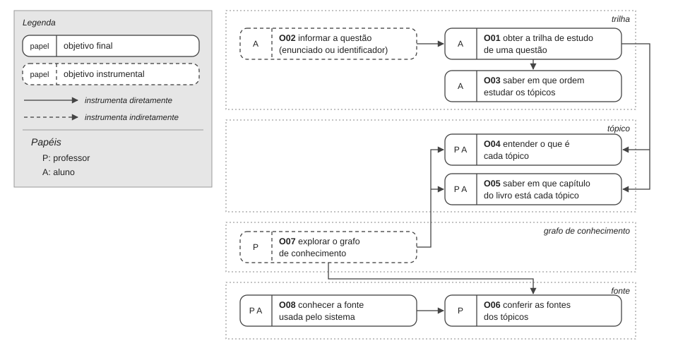

# Entrega 9 — Modelo conceitual e design centrado na comunicação

**Data:** 31/10/2026  
**Status:** 🟨 em andamento  
**Responsabilidade:** soluções individuais, com consolidação da equipe para mapa de objetivos e esquema de signos.

## Objetivo da atividade

Passar do cenário de problema para uma concepção da interação, explicitando objetivos, tópicos de conversa, falas e signos que a interface deverá comunicar/manipular.

## Transformando resultados técnicos em conceitos compreensíveis

Em TCCs algorítmicos ou orientados a dados, esta entrega deve evitar que a interface exponha apenas estruturas internas do código. Identifique os **conceitos e signos que fazem sentido para o usuário**.

Exemplos:

- `query plan`, custo estimado, recomendação e impacto para um DBA;
- modelo, dataset, versão, execução e métrica para engenheiro de IA;
- período, indicador, grupo, tendência e filtro para gestor/analista;
- alerta, severidade, evidência, responsável e status para analista de segurança.

Se um termo técnico for necessário, modele como será comunicado, explicado e relacionado à tarefa.

Dashboards, relatórios, filtros e CRUDs devem aparecer no modelo conceitual por meio dos **objetivos, signos e conversas** que justificam sua existência.

## 1. Cenários de interação

Para cada cenário de problema, produza uma versão em que a solução já pode ser descrita. **Destaque claramente o texto alterado** em relação ao cenário original.

### CI01 — Descobrir o que estudar para resolver uma questão

**Autor(a):** Sebastian Citta — 24.123.068-9  
**Origem:** cenário problema C01

Rafael é graduando em Ciência da Computação e treina programação competitiva sozinho, no notebook. Ele programa com segurança e resolve sem ajuda as questões mais fáceis do Codeforces, mas ainda não sabe identificar, pelo enunciado, qual técnica uma questão exige. Hoje ele abriu um problema novo, com o enunciado em uma aba e o editor de código em outra, e o leu várias vezes. Escreveu uma primeira tentativa e submeteu, mas o veredito foi Wrong Answer. Ele entende o veredito, mas isso não o ajuda a saber o que fazer.

Rafael já viu as palavras dp, greedy e constructive algorithms nas etiquetas de problemas. Algumas ele reconhece de disciplinas do curso, mas não consegue dizer qual delas se aplica à questão, nem o que precisaria estudar antes. **[ALTERADO] Depois de mais duas submissões erradas, em vez de tentar por eliminação ou colar o enunciado em um LLM que lhe entregaria a solução, ele abre a ferramenta de trilhas e informa a questão: cola o enunciado inteiro ou, como a questão é do Codeforces, informa só o identificador. A ferramenta mostra que está montando a trilha e, em poucos segundos, apresenta os tópicos que ele precisa estudar e a ordem entre eles: o que precisa saber antes e o que vem depois.**

**[NOVO] Cada tópico traz uma explicação curta em português e o capítulo do Cormen onde é tratado. Rafael encontra "dynamic programming" na trilha e, pela explicação, entende que é programação dinâmica e que, antes dela, a trilha indica recursão. Um dos tópicos é básico e não tem capítulo no livro; a ferramenta deixa isso claro, e ele não perde tempo procurando no índice. Junto da trilha fica o aviso padrão de que a IA pode cometer erros.**

No meio disso, uma mensagem o interrompe, e ao voltar **[ALTERADO] a trilha continua aberta, e ele retoma do tópico em que tinha parado, sem precisar reler o enunciado para lembrar o que ia estudar.**

Rafael não quer a solução pronta, porque o objetivo é evoluir no treino. **[ALTERADO] A ferramenta não mostra a solução nem o código: mostra só o que estudar e onde. Rafael abre o capítulo indicado, estuda o tópico por onde a trilha começa e, quando consegue dizer com as próprias palavras por que a questão pede programação dinâmica, volta a ela e tenta de novo por conta própria.**

### Diferenças relevantes

| Alteração | Por que foi necessária | Evidência/artefato que justifica |
|---|---|---|
| Rafael informa a questão pelo enunciado ou pelo identificador | No C01 ele não tinha como descobrir o que estudar a partir da questão | Entrega 5, T01 (1.1 e 1.2); F01 |
| A ferramenta mostra que está montando a trilha | Sem retorno, ele não distingue "processando" de "travou" | F02; Entrega 8, tempo de processamento |
| A trilha mostra os tópicos e a ordem entre eles | No C01 as etiquetas davam o nome do assunto, mas não a ordem nem os pré-requisitos | N02, F03; lacuna declarada na implementação do TCC |
| Cada tópico tem explicação curta em português | Ele não associava `dp` a um conteúdo que soubesse estudar | N05, H05 |
| Cada tópico indica o capítulo do Cormen, ou que não tem capítulo | No C01 ele não sabia nem o nome do que procurar | N03, F04, H26 |
| A trilha vem com o aviso padrão de que a IA pode cometer erros | O modelo pode errar na atribuição de tópicos e não devolve grau de confiança por tópico | Entrega 8, restrições da plataforma |
| A trilha continua aberta depois da interrupção | No C01 ele precisava reler enunciado e código após cada interrupção | H24 |
| A ferramenta não entrega a solução | Rafael quer evoluir no treino, não receber a resposta | H07; C01 `[Q5]` |

### CI02 — Conferir as fontes do material antes de recomendá-lo

**Autor(a):** Juan Manuel Citta — 24.123.022-6  
**Origem:** cenário problema C02

> Mesma convenção do CI01.

Helena leciona em turmas grandes e, nos períodos de preparação para a competição, também treina o time de maratona da faculdade. Ela é especialista: lê o enunciado de uma questão e reconhece na hora a técnica que ela exige. O que falta para ela é tempo. Com poucas horas de aula e muitos alunos, não consegue atender individualmente quem trava, e o plano de treino da maratona acaba sendo montado às pressas.

Quando um aluno trava durante o treino, Helena costuma sugerir que ele consulte um dos modelos de IA disponíveis no mercado. Ela sabe que o aluno precisa de alguma ajuda, mas não tem como saber em quais fontes o modelo se baseia, nem se a explicação segue a mesma linha do material que ela já entregou à turma. **[ALTERADO] Antes de recomendar a ferramenta de trilhas ao time, Helena decide conferir de onde vem o conteúdo. Ela abre o grafo de conhecimento da ferramenta, que mostra todos os tópicos que podem aparecer nas trilhas e as dependências entre eles, e vê que a fonte usada é o Cormen, livro-texto que ela já conhece e considera confiável.**

**[NOVO] Ela procura no grafo os tópicos que vai trabalhar no próximo treino, como grafos e programação dinâmica. Para cada um, vê o capítulo do Cormen e a explicação curta em português, e confere se a ordem entre os tópicos é a mesma que ela usa em aula. Nos tópicos básicos, que não têm capítulo específico, a ferramenta deixa claro que não há capítulo, e ela entende que não se trata de uma falha.**

Helena não quer proibir os alunos de buscar apoio. O incômodo dela não é a IA em si, e sim a falta de controle sobre as fontes. **[ALTERADO] Como confirmou que os tópicos e capítulos seguem um livro que ela aprova, passa a indicar a ferramenta ao time. Ela continua sem ver o que cada aluno consultou, porque a ferramenta não mostra as perguntas dos alunos, mas sabe que as trilhas que eles recebem são montadas a partir dos mesmos tópicos e capítulos que ela conferiu.**

### Diferenças relevantes

| Alteração | Por que foi necessária | Evidência/artefato que justifica |
|---|---|---|
| Helena confere a fonte antes de recomendar a ferramenta | No C02 ela não tinha como saber em que fontes a IA se baseava | H25; C02 `[Q7]` e `[Q10]` |
| Ela acessa o grafo de conhecimento com todos os tópicos | Ela não tem acesso às perguntas dos alunos; o que pode verificar é o conjunto de tópicos de onde as trilhas saem | Entrega 5, T02 (2 — ver grafo completo) |
| A fonte usada é identificada como o Cormen | Ela confia em livros-texto reconhecidos | C02 `[Q7]`; Entrega 8, delimitação |
| Ela vê capítulo e explicação de cada tópico e a ordem entre eles | Ela precisa comparar com o material que já entregou à turma | Entrega 8, meta qualitativa de P02; MU04 |
| Tópicos sem capítulo são sinalizados | Sem isso, a ausência de capítulo pareceria erro da ferramenta | Comportamento atual do sistema (alguns tópicos não têm capítulo) |
| A ferramenta não mostra as perguntas dos alunos | Decisão de escopo: o professor tem acesso apenas ao grafo geral | Entrega 8, papéis/permissões |

## 2. Design centrado na comunicação

**Nome do cenário:** CI01

| Tópico > subtópico | Falas e signos envolvidos | Intenção/efeito esperado |
|---|---|---|
| obter trilha de estudo para uma questão | `U: Travei nesta questão e não sei o que estudar.` | Iniciar a consulta sem nenhuma configuração prévia (N01) |
| > informar questão | `D: Cole o enunciado da questão ou informe o identificador dela no Codeforces.` / `U: [enunciado]` ou `U: [identificador]` | Aceitar a questão do jeito que o aluno a tem em mãos |
| > informar questão (entrada inválida) | `U: [texto vazio ou que não é um enunciado]` / `D: Isso não parece o enunciado de uma questão. Cole o enunciado completo ou o identificador (por exemplo, 1850B).` | Recuperar a conversa sem perder o que o aluno digitou |
| > acompanhar geração da trilha | `D: Estou montando a trilha para esta questão.` | O aluno sabe que o sistema está trabalhando e não reenvia |
| > acompanhar geração da trilha (falha) | `D: Não consegui montar a trilha agora. Verifique sua conexão e tente novamente em instantes.` | O aluno entende que o problema não é a questão dele |
| > examinar trilha | `D: Para esta questão, estude estes tópicos, nesta ordem: [tópico] → [tópico] → ...` / `U: Por onde começo?` / `D: Comece por [tópico inicial], que não depende de nenhum outro.` | Saber em que ordem estudar (N02) |
| > aviso de erro da IA | `D: Esta trilha foi gerada por IA e pode conter erros.` | Não apresentar a trilha como certa, já que o modelo não devolve confiança por tópico |
| entender um tópico | `U: O que é [tópico]?` / `D: [explicação curta em português]` | Ligar o termo em inglês a um conteúdo que o aluno sabe estudar (N05) |
| > localizar fonte do tópico | `U: Onde estudo isso?` / `D: No Cormen, capítulo [n] — [título do capítulo].` | Chegar ao material sem saber o nome do assunto (N03) |
| > tópico sem capítulo | `U: Onde estudo [tópico básico]?` / `D: Este é um conceito básico e não tem capítulo específico no livro.` | Evitar que a ausência de capítulo pareça erro |

**Convenção:** `U` = usuário; `D` = preposto do designer/sistema, conforme a abordagem de Engenharia Semiótica adotada na disciplina.

**Nome do cenário:** CI02

| Tópico > subtópico | Falas e signos envolvidos | Intenção/efeito esperado |
|---|---|---|
| conferir as fontes dos tópicos | `U: Quero ver de onde vem o conteúdo que a ferramenta usa.` | Permitir ao professor verificar a fonte antes de recomendar a ferramenta (H25) |
| > conhecer a fonte usada | `D: Todas as trilhas são montadas a partir do Cormen, Introduction to Algorithms.` | Identificar de imediato um livro que o professor reconhece |
| > explorar o grafo de conhecimento | `D: Este é o grafo de conhecimento, com todos os tópicos e as dependências entre eles.` | Mostrar o conjunto de onde as trilhas saem, sem expor perguntas de alunos |
| > localizar tópico | `U: Quero ver [tópico].` / `D: Aqui está [tópico], com os tópicos de que ele depende e os que dependem dele.` | Chegar rápido aos tópicos do próximo treino (MU05) |
| > localizar tópico (não encontrado) | `U: [termo que não existe no grafo]` / `D: Não encontrei esse tópico. Os tópicos estão em inglês; tente, por exemplo, "graphs".` | Recuperar a busca sem que o professor conclua que o tópico falta |
| > examinar fonte do tópico | `U: De onde vem este tópico?` / `D: Cormen, capítulo [n] — [título do capítulo]. [explicação curta em português]` | Comparar com o material já entregue à turma (MU04) |
| > tópico sem capítulo | `D: Este é um conceito básico e não tem capítulo específico no livro.` | Evitar que a ausência de capítulo pareça falha da fonte |

**Convenção:** `U` = usuário; `D` = preposto do designer/sistema, conforme a abordagem de Engenharia Semiótica adotada na disciplina.

## 3. Mapa de objetivos

Cada integrante apresenta seu mapa e a equipe cria um **mapa consolidado**, eliminando duplicidades e resolvendo conflitos de nomenclatura.

### Dicionário de objetivos

| ID | Objetivo | Persona(s) | Cenário(s) | Prioridade |
|---|---|---|---|---|
| O01 | Obter a trilha de estudo de uma questão | P01 | CI01 | alta |
| O02 | Informar a questão (enunciado ou identificador) | P01 | CI01 | alta |
| O03 | Saber em que ordem estudar os tópicos | P01 | CI01 | alta |
| O04 | Entender o que é cada tópico | P01, P02 | CI01, CI02 | alta |
| O05 | Saber em que capítulo do livro está cada tópico | P01, P02 | CI01, CI02 | alta |
| O06 | Conferir as fontes dos tópicos | P02 | CI02 | média |
| O07 | Explorar o grafo de conhecimento | P02 | CI02 | média |
| O08 | Conhecer a fonte usada pelo sistema | P01, P02 | CI01, CI02 | média |

Consolidação: "saber onde estudar cada tópico" (CI01) e "ver o capítulo de cada tópico" (CI02) eram o mesmo objetivo com nomes diferentes e viraram O05; "ler a explicação do tópico" virou O04 nos dois cenários.

## 4. Esquema conceitual de signos

Consolide as informações em **uma tabela única**.

| Grupo | Signo | Origem | Observações/semântica | Tipo de conteúdo | Restrição | Valor padrão | Prevenção | Recuperação |
|---|---|---|---|---|---|---|---|---|
| Questão | enunciado | domínio | Texto da questão copiado do juiz online pelo aluno | texto longo | não nulo; deve ser o enunciado de uma questão | — | PP: indicar que o enunciado pode ser colado inteiro | RA: explicar que o texto não parece um enunciado, mantendo o texto para correção |
| Questão | identificador da questão | domínio | Código da questão no Codeforces, alternativo ao enunciado | texto curto | formato do Codeforces (número + letra, ex.: 1850B) | — | PP: exemplo do formato; PA: impedir envio vazio | RA: avisar que o formato é inválido; CE: se a questão não existir, sugerir colar o enunciado |
| Consulta | estado da consulta | aplicação | Indica se a trilha está sendo montada, pronta ou se houve falha | estado (montando / pronta / falha) | — | montando, logo após o envio | PA: impedir novo envio enquanto monta | CE: falha de conexão ou serviço indisponível; orientar a tentar novamente em instantes |
| Trilha | trilha de estudo | aplicação | Tópicos necessários para uma questão e a ordem entre eles; não contém a solução | conjunto ordenado de tópicos | ao menos um tópico | — | — | CE: se não houver trilha, informar e sugerir revisar o enunciado |
| Trilha | tópico | domínio | Conceito algorítmico com o nome usado no Codeforces, em inglês (ex.: `dp`, `greedy`) | texto curto | — | — | PP: explicação em português junto ao nome | — |
| Trilha | dependência entre tópicos | domínio | Relação "estude A antes de B" | relação entre dois tópicos | sem ciclos | — | PP: deixar claro o sentido da dependência | — |
| Trilha | tópico inicial | aplicação | Tópico da trilha que não depende de nenhum outro: por onde começar | derivado da trilha | — | destacado na trilha | — | — |
| Trilha | aviso de erro da IA | aplicação | Aviso padrão e fixo de que a IA pode cometer erros; não é calculado por tópico nem por consulta | texto fixo | — | sempre visível junto à trilha | PP: lembrar que a trilha pode conter erros | — |
| Tópico | explicação do tópico | aplicação | Explicação curta em português do que é o tópico | texto curto | — | — | — | — |
| Fonte | livro-fonte | domínio | *Introduction to Algorithms* (Cormen et al.), único livro usado para montar as trilhas | texto | — | Cormen | — | — |
| Fonte | capítulo | domínio | Capítulo do Cormen que trata do tópico | número + título | opcional: tópicos básicos não têm capítulo | "sem capítulo específico" | PP: informar que o tópico é básico e não tem capítulo | — |
| Grafo | grafo de conhecimento | aplicação | Todos os tópicos e dependências de onde as trilhas saem; não mostra perguntas de alunos | conjunto de tópicos e dependências | — | visão geral do grafo | — | — |
| Grafo | busca de tópico | aplicação | Termo usado pelo professor para localizar um tópico no grafo | texto curto | — | vazio | PP: exemplo de termo em inglês | RA: informar que o tópico não foi encontrado e sugerir outro termo |

Siglas: **PP** = prevenção passiva; **PA** = prevenção ativa; **RA** = recuperação apoiada; **CE** = captura de erro (Barbosa e Silva, 2010).

### Regras para os signos

- Use o vocabulário do domínio do usuário.
- Evite duplicar o mesmo conceito com nomes diferentes.
- Diferencie informação fornecida pelo usuário, produzida pelo sistema e derivada do domínio.
- Registre prevenção e recuperação apenas quando fizer sentido; explique as siglas usadas.

## Síntese

Quais objetivos/tópicos/signos deverão necessariamente aparecer nos diagramas MoLIC?

- **Objetivos:** O01 a O08, com os mesmos nomes do dicionário. O fluxo do aluno parte de O01 (CI01); o do professor, de O06 (CI02). O04, O05 e O08 são comuns aos dois.
- **Tópicos de conversa:** informar questão, acompanhar geração da trilha, examinar trilha, entender um tópico, localizar fonte do tópico, conhecer a fonte usada, explorar o grafo de conhecimento, localizar tópico e examinar fonte do tópico.
- **Signos:** enunciado, identificador da questão, estado da consulta, trilha de estudo, aviso de erro da IA, tópico, dependência entre tópicos, tópico inicial, explicação do tópico, livro-fonte, capítulo, grafo de conhecimento e busca de tópico.
- **Rupturas a modelar:** entrada inválida (RA), questão inexistente (CE), falha ao montar a trilha (CE), tópico sem capítulo (PP) e tópico não encontrado na busca (RA).

## Checklist

- [ ] Cenários de interação mostram alterações em relação aos cenários de problema.
- [ ] Cada solução individual identifica autor e cenário de origem.
- [ ] Tópicos/falas/signos são coerentes com objetivos do usuário.
- [ ] Mapas individuais foram consolidados.
- [ ] O esquema de signos está em uma tabela única e sem duplicações conceituais.
- [ ] Nomes de objetivos/signos serão reutilizados na Entrega 10.
- [ ] Em TCC técnico, signos representam conceitos do domínio compreensíveis ao usuário, não apenas variáveis/estruturas internas.
- [ ] Padrões como dashboard, relatório, filtros, administração e CRUD possuem objetivos e signos correspondentes.
- [ ] A interface comunica não só o resultado técnico, mas também seu significado para a tarefa.
