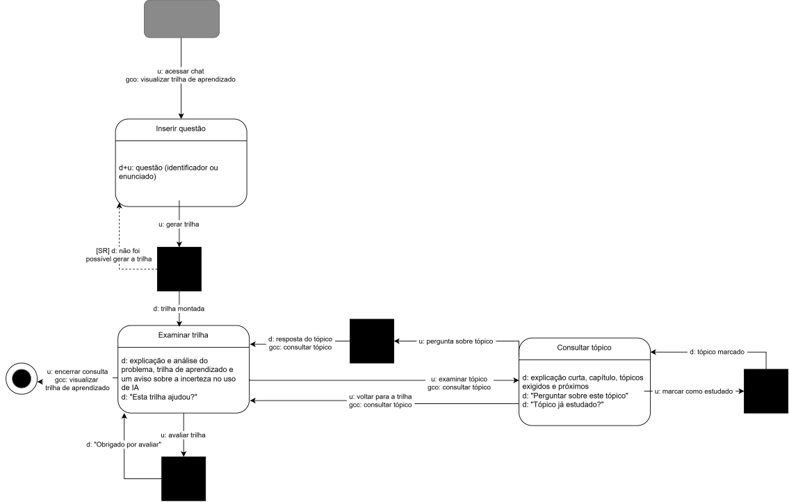
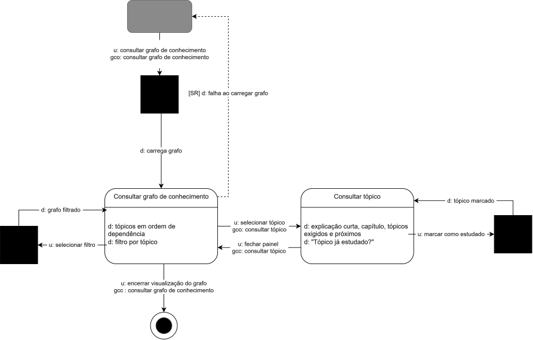

# Entrega 10: MoLIC

**Data:** 17/11/2026  
**Status:** 🟨 em andamento  
**Responsabilidade:** 1 solução completa por integrante

## Objetivo da atividade

Modelar a interação como uma **conversa entre usuário e preposto do designer**, oferecendo visão global dos caminhos que permitem ao usuário atingir seus objetivos, incluindo alternativas e rupturas relevantes. MoLIC não deve ser reduzida a um fluxograma de telas.

> Use a **notação MoLIC ensinada na disciplina**. Este template foca critérios de qualidade e não substitui a legenda/notação apresentada em aula.

## Atenção a TCCs sem interface original

O MoLIC não modela o algoritmo por dentro. Ele modela a **conversa de interação necessária para que uma pessoa use a contribuição**.

Exemplos de conversas:

- usuário escolhe dados/parâmetros → sistema valida → usuário inicia análise → sistema comunica processamento → usuário interpreta resultado;
- usuário consulta histórico → refina filtros → abre execução → compara com outra;
- administrador seleciona perfil → altera permissão → sistema comunica consequências → administrador confirma/cancela;
- analista recebe alerta → examina evidências → classifica ocorrência → registra decisão.

Modele também rupturas plausíveis: entrada inválida, falha de processamento, ausência de resultado, permissão insuficiente, filtro sem resultados, conflito de alteração, cancelamento ou necessidade de recuperação.

## M01: Obter a trilha de estudo

**Autor(a):** Sebastian Citta, 24.123.068-9  
**Cenário de interação de origem:** CI01  
**Objetivo(s):** O01 (principal), O02, O03, O04, O05 e O06  
**Tarefa(s) relacionada(s):** T01  
**Signos relevantes:** enunciado, identificador da questão, trilha de estudo, aviso de erro da IA, avaliação da trilha, tópico, dependência entre tópicos, explicação do tópico, capítulo, marca de estudado, pergunta sobre o tópico e resposta sobre o tópico.

### Diagrama

**Fonte editável:** [M01.svg](../assets/10_molic/M01.svg). O SVG foi exportado pelo draw.io e guarda o diagrama, então abre direto no draw.io para edição.

### Leitura do diagrama

O usuário entra na conversa pelo acesso ubíquo "acessar chat", que leva à cena de inserir a questão. Como esse acesso fica sempre disponível, o usuário pode voltar a ele e fazer uma nova questão a partir de qualquer cena.

Nas transições, "gco" marca o começo de um objetivo e "gcc" marca a sua conclusão. O objetivo "visualizar trilha de aprendizado" começa em "acessar chat" e termina em "encerrar consulta". O objetivo "consultar tópico" começa em "examinar tópico" e termina quando a conversa volta para a trilha, por "voltar para a trilha" ou pela resposta sobre o tópico. Avaliar a trilha e marcar o tópico como estudado acontecem dentro de um objetivo já aberto, por isso não têm gco nem gcc.

O detalhe do tópico abre num painel ao lado do chat (P05 da Entrega 6). No MoLIC ele é uma cena separada, porque o assunto da conversa muda para o tópico. A posição na tela é decisão do protótipo.

#### Caminho principal

1. Acesso ubíquo → "u: acessar chat" → cena **Inserir questão** (O02).
2. Em Inserir questão, o usuário informa a questão pelo enunciado ou pelo identificador e envia ("u: gerar trilha").
3. O sistema processa a questão e responde "d: trilha montada", levando à cena **Examinar trilha** (O01). A cena mostra a explicação e a análise do problema, a trilha de aprendizado e o aviso de que a IA pode errar.
4. O usuário abre um tópico da trilha ("u: examinar tópico") e vai para a cena **Consultar tópico** (O04). A cena mostra a explicação curta, o capítulo e os tópicos exigidos e próximos.
5. O usuário marca o tópico como estudado ("u: marcar como estudado"). O sistema registra e responde "d: tópico marcado", e a conversa continua em Consultar tópico (O05).
6. O usuário volta para a trilha ("u: voltar para a trilha").
7. O usuário avalia a trilha ("u: avaliar trilha"). O sistema responde "d: Obrigado por avaliar" e a conversa continua em Examinar trilha (O03).
8. O usuário encerra a consulta ("u: encerrar consulta"), e a conversa chega ao ponto de encerramento.

#### Alternativas e rupturas

| Situação | Onde ocorre | Como o usuário percebe | Caminho de recuperação/saída |
|---|---|---|---|
| Entrada não reconhecida ou falha do modelo | Processamento após "u: gerar trilha" | d: não foi possível gerar a trilha | Volta para Inserir questão, onde pode tentar de novo |
| Dúvida sobre um tópico (O06) | Consultar tópico | Envia "u: pergunta sobre tópico" e recebe "d: resposta do tópico" no chat | A resposta aparece no chat, então a conversa volta para Examinar trilha |
| Quer resolver outra questão | Qualquer cena | Acesso ubíquo "acessar chat" sempre disponível | Leva a Inserir questão |
| Não quer abrir tópicos nem avaliar | Examinar trilha | "u: encerrar consulta" | Ponto de encerramento |

### Checklist específico de modelagem

- [X] Existe **ponto de abertura** coerente com o início do objetivo.
- [x] As **cenas de conversa** representam tópicos/assuntos, não nomes de páginas apenas.
- [x] As transições/falas deixam claro o que o usuário ou o sistema comunica.
- [x] Há **ponto(s) de encerramento** para objetivos concluídos/abandonados quando aplicável.
- [x] Processamentos do sistema estão representados conforme a notação adotada em aula, sem "inventar" fala do usuário.
- [ ] Rupturas (breakdowns) relevantes têm feedback e caminho de recuperação, não becos sem saída.
- [x] Acessos ubíquos/atalhos só aparecem quando semanticamente justificáveis.
- [x] O diagrama cobre caminhos alternativos importantes, e não apenas o "happy path".
- [X] Nomes de objetivos, tópicos e signos são coerentes com a Entrega 9.
- [X] O diagrama é legível em tamanho normal no GitHub.
- [x] O MoLIC representa a conversa usuário/sistema, não o fluxo interno do algoritmo.
- [x] Processamento, filtros, administração, relatórios e históricos incluem retornos/rupturas quando relevantes.

## M02: Consultar o grafo de conhecimento

**Autor(a):** Juan Manuel Citta, 24.123.022-6  
**Cenário de interação de origem:** CI02  
**Objetivo(s):** O07 (principal), O04 e O05  
**Tarefa(s) relacionada(s):** T02  
**Signos relevantes:** grafo de conhecimento, tópico, dependência entre tópicos, filtro por tópico, explicação do tópico, capítulo e marca de estudado.

### Diagrama

**Fonte editável:** [M02.svg](../assets/10_molic/M02.svg). O SVG foi exportado pelo draw.io e guarda o diagrama, então abre direto no draw.io para edição.

### Leitura do diagrama

O grafo de conhecimento não depende de uma questão informada. Por isso o usuário chega a ele pelo acesso ubíquo "consultar grafo de conhecimento", de qualquer ponto da aplicação.

Os filtros e a escolha de um tópico são opções de um clique. Por isso a cena só mostra a opção (d:), e a escolha do usuário aparece como fala na transição (u:). 

O objetivo "consultar grafo de conhecimento" começa (gco) no acesso ubíquo e termina (gcc) em "encerrar visualização do grafo". O objetivo "consultar tópico" começa em "selecionar tópico" e termina em "fechar painel".

A cena Consultar tópico é a mesma do M01, agora aberta num painel ao lado do grafo de conhecimento. O tópico acessado a partir da cena do grafo de conhecimento não tem a opção de "Perguntar sobre o tópico" (O06).

#### Caminho principal

1. Acesso ubíquo → "u: consultar grafo de conhecimento" → processamento, que carrega o grafo.
2. "d: carrega grafo" → cena **Consultar grafo de conhecimento** (O07). A cena mostra os tópicos em ordem de dependência e o filtro por tópico.
3. O usuário seleciona um filtro ("u: selecionar filtro"). O sistema responde "d: grafo filtrado", e a conversa continua na mesma cena. Para ver o grafo completo de novo, o usuário seleciona o filtro "Todas".
4. O usuário seleciona um tópico ("u: selecionar tópico") e vai para a cena **Consultar tópico** (O04). A cena mostra a explicação curta, o capítulo e os tópicos exigidos e próximos.
5. O usuário marca o tópico como estudado ("u: marcar como estudado"). O sistema responde "d: tópico marcado", e a conversa continua em Consultar tópico (O05).
6. O usuário fecha o painel ("u: fechar painel") e volta ao grafo.
7. O usuário encerra a consulta ("u: encerrar visualização do grafo"), e a conversa chega ao ponto de encerramento.

#### Alternativas e rupturas

| Situação | Onde ocorre | Como o usuário percebe | Caminho de recuperação/saída |
|---|---|---|---|
| Falha ao carregar o grafo | Ao abrir o grafo de conhecimento | [SR] d: falha ao carregar grafo | Volta ao acesso ubíquo, de onde pode tentar de novo |
| Quer ver só uma parte do grafo | Consultar grafo de conhecimento | Seleciona um filtro e recebe "d: grafo filtrado" | O filtro "Todas" volta ao grafo completo |
| Quer os detalhes de um tópico | Consultar grafo de conhecimento | O painel do tópico abre ao lado do grafo | "u: fechar painel" volta ao grafo |
| Não quer continuar | Consultar grafo de conhecimento | "u: encerrar visualização do grafo" | Ponto de encerramento |

### Checklist específico de modelagem

- [X] Existe **ponto de abertura** coerente com o início do objetivo.
- [x] As **cenas de conversa** representam tópicos/assuntos, não nomes de páginas apenas.
- [x] As transições/falas deixam claro o que o usuário ou o sistema comunica.
- [x] Há **ponto(s) de encerramento** para objetivos concluídos/abandonados quando aplicável.
- [x] Processamentos do sistema estão representados conforme a notação adotada em aula, sem "inventar" fala do usuário.
- [x] Rupturas (breakdowns) relevantes têm feedback e caminho de recuperação, não becos sem saída.
- [x] Acessos ubíquos/atalhos só aparecem quando semanticamente justificáveis.
- [x] O diagrama cobre caminhos alternativos importantes, e não apenas o "happy path".
- [X] Nomes de objetivos, tópicos e signos são coerentes com a Entrega 9.
- [X] O diagrama é legível em tamanho normal no GitHub.
- [x] O MoLIC representa a conversa usuário/sistema, não o fluxo interno do algoritmo.
- [x] Processamento, filtros, administração, relatórios e históricos incluem retornos/rupturas quando relevantes.

## Consolidação da equipe

### Cobertura dos objetivos

| Objetivo | MoLIC que cobre | Lacunas/duplicidades | Decisão |
|---|---|---|---|
| O01 Obter a trilha de estudo | M01 | Nenhuma | Objetivo principal do M01 |
| O02 Informar a questão | M01 | Nenhuma | Cena Inserir questão |
| O03 Avaliar a trilha | M01 | Nenhuma | Ciclo de avaliação em Examinar trilha |
| O04 Visualizar detalhes do tópico | M01 e M02 | Mesma cena nos dois | Cena Consultar tópico, aberta pela trilha (M01) ou pelo grafo (M02) |
| O05 Marcar tópico como estudado | M01 e M02 | Mesmo ciclo nos dois | Ciclo em Consultar tópico |
| O06 Perguntar sobre um tópico | M01 | No M02 o painel aparece sem a pergunta | Resposta aparece no chat |
| O07 Consultar o grafo de conhecimento | M02 | Nenhuma | Objetivo principal do M02, acessado de qualquer ponto pelo acesso ubíquo |

### Preparação para o Figma

Estados que saem das conversas do M01 e do M02 (entre parênteses, a tela correspondente da Entrega 6).

M01:

- chat vazio, pronto para receber a questão (P01);
- processando a questão (P03);
- falha: não foi possível gerar a trilha, com opção de tentar de novo (P06);
- trilha montada, com explicação do problema, aviso de que a IA pode errar e o botão "Esta trilha ajudou?" (P04);
- confirmação da avaliação: "Obrigado por avaliar";
- painel do tópico ao lado do chat, com explicação curta, capítulo, tópicos exigidos e próximos e os botões de perguntar e de marcar como estudado (P05);
- tópico marcado como estudado;
- resposta sobre o tópico no chat.

M02:

- carregando o grafo de conhecimento;
- falha ao carregar o grafo;
- grafo completo, com os tópicos em ordem de dependência e os filtros (P07);
- grafo filtrado, com o filtro "Todas" para voltar (P08);
- painel do tópico ao lado do grafo, com explicação curta, capítulo, tópicos exigidos e próximos e o botão de marcar como estudado;
- tópico marcado como estudado.

## Erros frequentes a evitar

- desenhar apenas caixas com nomes de telas e setas de navegação;
- não modelar falhas, cancelamento, volta ou recuperação;
- usar rótulos genéricos ("Tela 1", "Processo 2") sem tópico de conversa;
- criar no Figma fluxos que não existem no MoLIC;
- diagrama sem legenda/fonte editável e com texto ilegível.
