# Entrega 11: Protótipo no Figma

**Data:** 17/11/2026  
**Status:** 🟨 em andamento  
**Responsabilidade:** 1 protótipo integrado por equipe cobrindo os fluxos MoLIC. Se a turma exigir divisão individual, identifique o responsável por cada fluxo/tela.

## Objetivo da atividade

Materializar o modelo de interação em um protótipo navegável, preservando a lógica dos objetivos, tópicos, signos, feedbacks, alternativas e recuperações definidos anteriormente.

## Biblioteca de possibilidades para projetos técnicos

O protótipo deve materializar os fluxos definidos nas entregas anteriores. Dependendo do escopo, podem fazer sentido:

1. **Dashboard:** indicadores, alertas, estado, tendências e atalhos para tarefas frequentes.
2. **Configuração/parametrização:** escolhas, presets, validação e explicação de opções técnicas.
3. **Entrada de dados:** upload, conexão, seleção, pré-visualização e validação.
4. **Processamento:** fila, status, progresso, cancelamento, falha e reexecução.
5. **Relatório/resultados:** síntese, métricas, gráficos, explicação, exportação e compartilhamento.
6. **Histórico:** busca, filtros, ordenação, paginação, detalhes e repetição de execução.
7. **Comparação:** antes/depois, modelo A/B, execução A/B, baseline ou períodos.
8. **Explicabilidade:** confiança, fatores, evidências, limitações e correção/contestação.
9. **Administração:** usuários, grupos, perfis, permissões, integrações e políticas.
10. **CRUDs de domínio:** somente quando criar/consultar/editar/excluir representa tarefa real.
11. **Auditoria/logs:** histórico de alterações e eventos em linguagem adequada.
12. **Alertas/ocorrências:** severidade, impacto, ação, responsável e resolução.
13. **Ajuda/documentação:** apoio contextual a tarefas complexas.

### Estados que não podem ser esquecidos

Quando aplicável, considere: vazio/sem dados; carregamento/processamento; sucesso; erro de entrada; erro de processamento; filtro sem resultados; permissão insuficiente; confirmação de ação destrutiva; cancelamento/desfazer/recuperação; dados desatualizados/conflito.

> Esta lista é repertório de design, **não uma exigência de quantidade de telas**. A rastreabilidade deve explicar por que cada tela existe.

## Link do Figma

**Protótipo:** {{URL}}  
**Arquivo editável:** {{URL}}  
**Última verificação de permissão:** {{dd/mm/aaaa}}

> Teste o link em janela anônima. O avaliador deve conseguir abrir o protótipo sem solicitar permissão.

## Cobertura MoLIC → Figma

| MoLIC | Objetivo | Fluxo/telas no Figma | Estados de erro/recuperação | Responsável |
|---|---|---|---|---|
| M01 | O01, O02 | `F01 → F02 → F03` | `F02E` (falha ao gerar a trilha, volta a F01) | Sebastian Citta |
| M01 | O03 | `F03 → F07` | Não se aplica | Sebastian Citta |
| M01 | O04, O05 | `F03 → F04 → F05` | Não se aplica | Sebastian Citta |
| M01 | O06 | `F04 → F06` | Não se aplica | Sebastian Citta |
| M02 | O07 | `F08 → F09 → F11` | `F08E` (falha ao carregar o grafo, pendente) | Juan Manuel Citta |
| M02 | O04, O05 | `F09 → F10` | Não se aplica | Juan Manuel Citta |

## Catálogo de telas/estados

Os prints abaixo foram capturados da aplicação em funcionamento.

### F01: Chat vazio

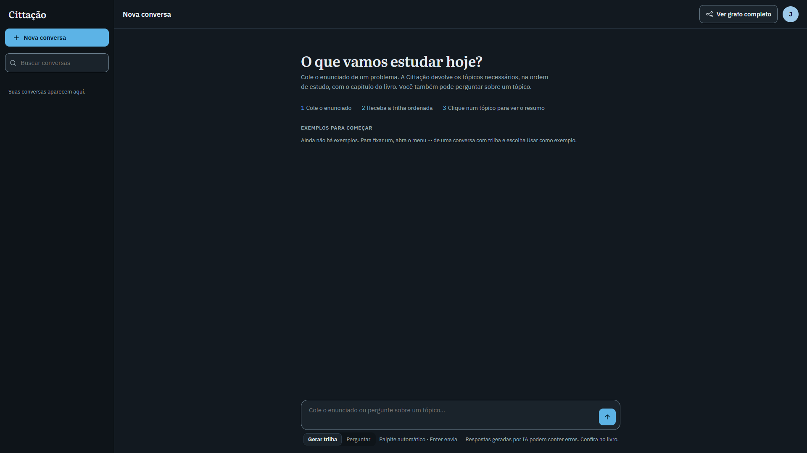

**Objetivo do usuário:** informar a questão (O02).  
**Signos principais:** enunciado, identificador da questão, modo "Gerar trilha", aviso de que a IA pode errar.  
**Origem no MoLIC:** M01, cena Inserir questão.

### F02: Processando a questão

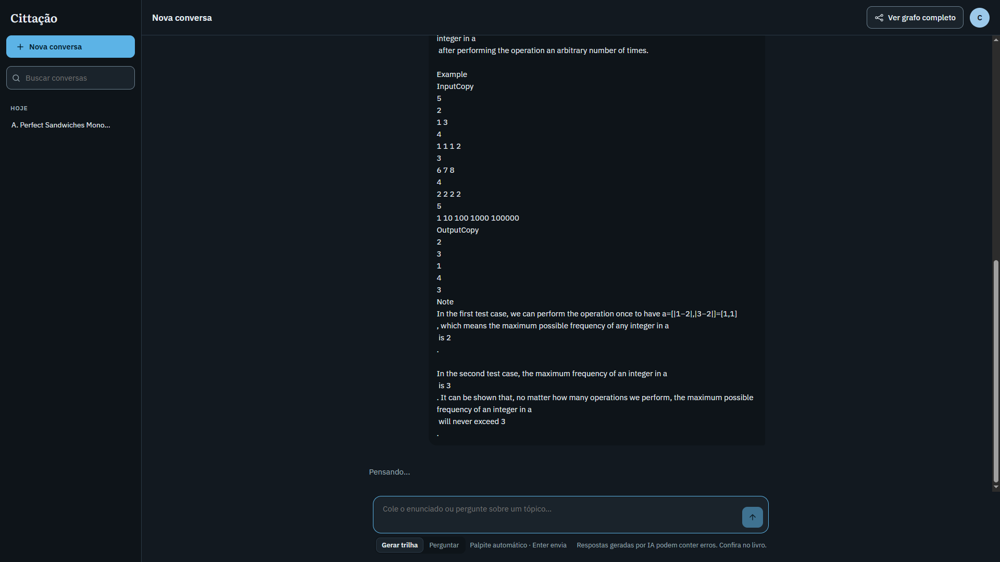

**Objetivo do usuário:** obter a trilha de estudo (O01).  
**Signos principais:** estado da consulta ("Pensando...").  
**Origem no MoLIC:** M01, processamento após "u: gerar trilha".

### F02E: Falha ao gerar a trilha

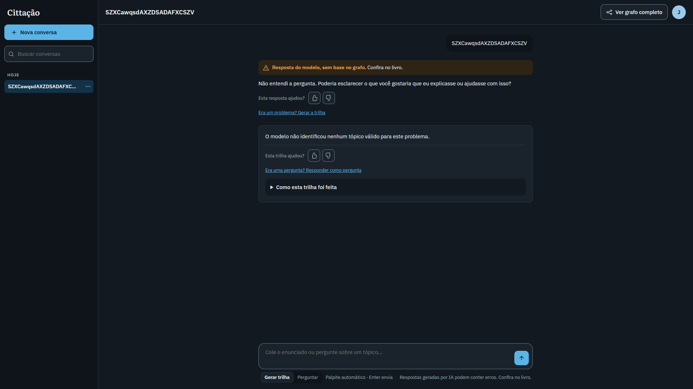

**Objetivo do usuário:** obter a trilha de estudo (O01).  
**Signos principais:** aviso "O modelo não identificou nenhum tópico válido para este problema", aviso de resposta sem base no grafo, campo para tentar de novo.  
**Origem no MoLIC:** M01, ruptura "[SR] d: não foi possível gerar a trilha", que volta a Inserir questão.

### F03: Trilha montada

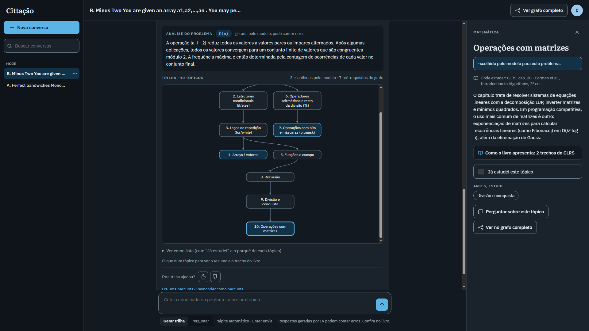

**Objetivo do usuário:** obter a trilha de estudo (O01).  
**Signos principais:** análise do problema, trilha de estudo, dependência entre tópicos, aviso de erro da IA ("gerada pelo modelo, pode conter erros"), avaliação da trilha ("Esta trilha ajudou?").  
**Origem no MoLIC:** M01, cena Examinar trilha.

### F04: Painel do tópico

**Objetivo do usuário:** visualizar detalhes do tópico (O04).  
**Signos principais:** tópico, explicação do tópico, livro-fonte e capítulo, tópicos exigidos ("Antes, estude") e próximos ("Depois, este tema leva a"), marca de estudado, pergunta sobre o tópico.  
**Origem no MoLIC:** M01, cena Consultar tópico.

### F05: Tópico marcado como estudado

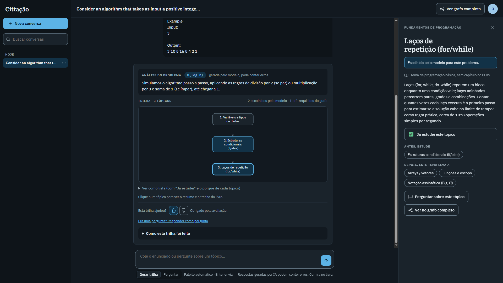

**Objetivo do usuário:** marcar tópico como estudado (O05).  
**Signos principais:** marca de estudado ("Já estudei este tópico" marcado).  
**Origem no MoLIC:** M01, ciclo "u: marcar como estudado" → "d: tópico marcado".

### F06: Resposta sobre o tópico

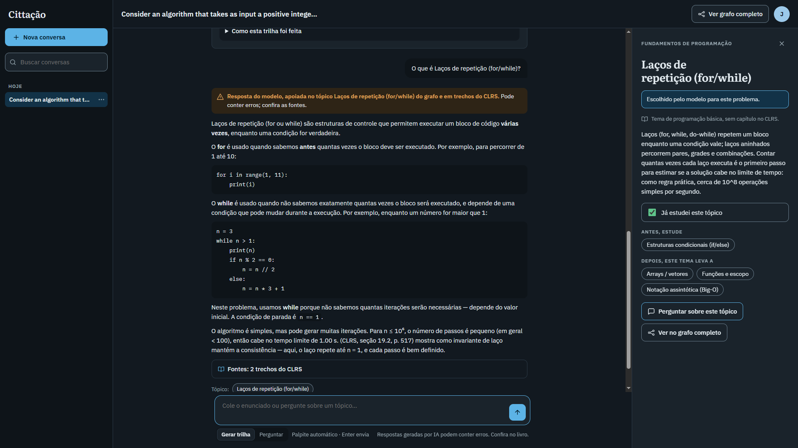

**Objetivo do usuário:** perguntar sobre um tópico (O06).  
**Signos principais:** pergunta sobre o tópico, resposta sobre o tópico, aviso de que a resposta se apoia no grafo e em trechos do CLRS, fontes.  
**Origem no MoLIC:** M01, "u: pergunta sobre tópico" → "d: resposta do tópico", que volta a Examinar trilha.

### F07: Avaliação registrada

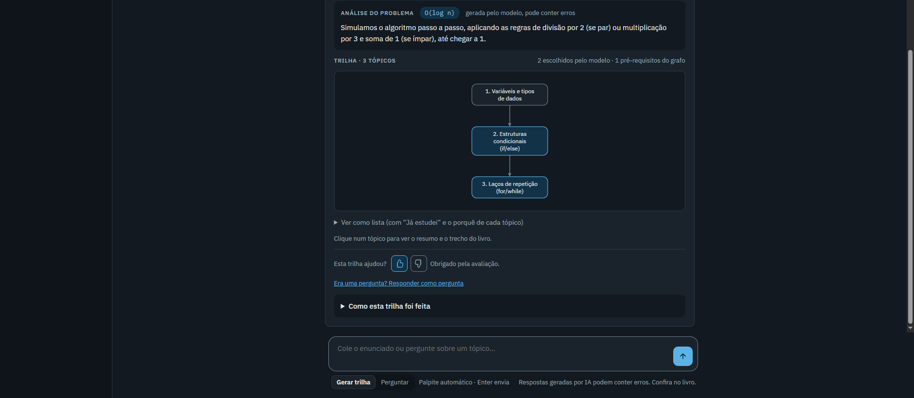

**Objetivo do usuário:** avaliar a trilha (O03).  
**Signos principais:** avaliação da trilha (polegar marcado), confirmação "Obrigado pela avaliação".  
**Origem no MoLIC:** M01, ciclo "u: avaliar trilha" → "d: Obrigado por avaliar".

### F08: Carregando o grafo

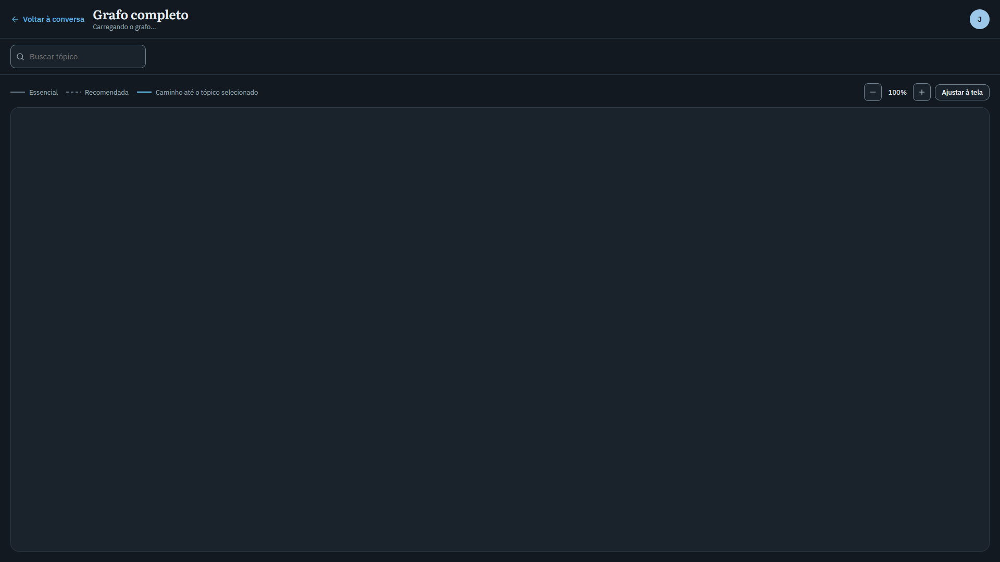

**Objetivo do usuário:** consultar o grafo de conhecimento (O07).  
**Signos principais:** estado da consulta ("Carregando o grafo...").  
**Origem no MoLIC:** M02, processamento após "u: consultar grafo de conhecimento".

### F08E: Falha ao carregar o grafo

{{print pendente}}

**Objetivo do usuário:** consultar o grafo de conhecimento (O07).  
**Signos principais:** {{...}}  
**Origem no MoLIC:** M02, ruptura "[SR] d: falha ao carregar grafo", que volta ao acesso ubíquo.

### F09: Grafo completo

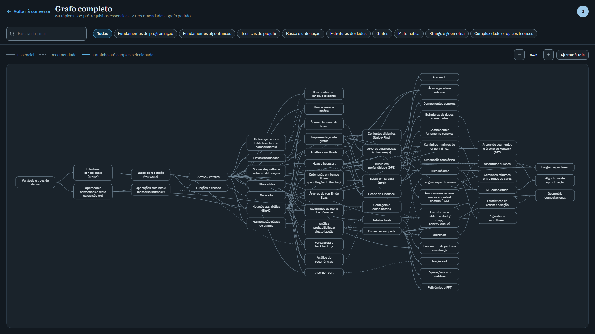

**Objetivo do usuário:** consultar o grafo de conhecimento (O07).  
**Signos principais:** grafo de conhecimento, tópico, dependência entre tópicos (essencial ou recomendada), filtro por área ("Todas" selecionado), busca de tópico.  
**Origem no MoLIC:** M02, cena Consultar grafo de conhecimento.

### F10: Tópico aberto no grafo

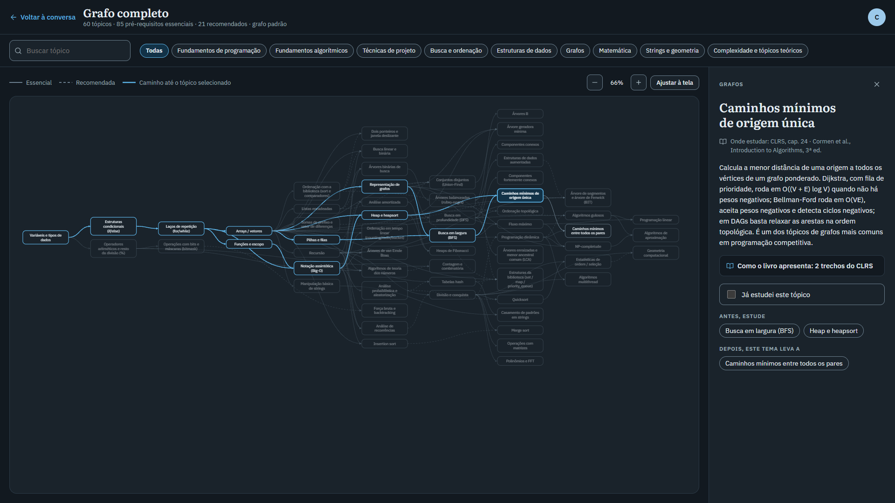

**Objetivo do usuário:** visualizar detalhes do tópico (O04) e marcar tópico como estudado (O05).  
**Signos principais:** caminho até o tópico selecionado, explicação do tópico, livro-fonte e capítulo, tópicos exigidos e próximos, marca de estudado.  
**Origem no MoLIC:** M02, cena Consultar tópico, aberta por "u: selecionar tópico".

### F11: Grafo filtrado

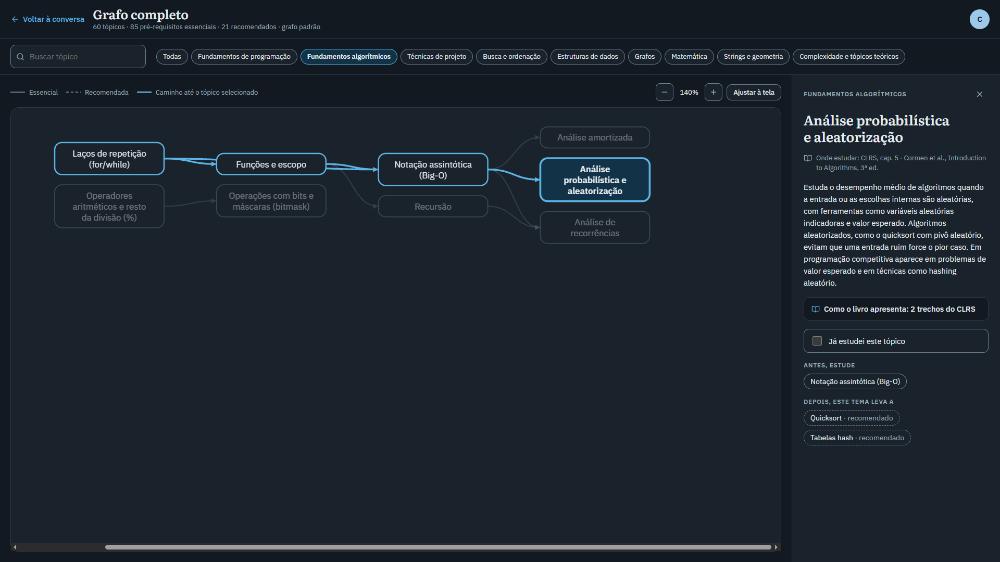

**Objetivo do usuário:** consultar o grafo de conhecimento (O07).  
**Signos principais:** filtro por área ("Fundamentos algorítmicos" selecionado), filtro "Todas" para voltar ao grafo completo.  
**Origem no MoLIC:** M02, ciclo "u: selecionar filtro" → "d: grafo filtrado".

## Sistema visual e consistência

| Elemento | Regra adotada | Justificativa |
|---|---|---|
| Tipografia | Fonte serifada nos títulos (nome da aplicação, título do grafo e do tópico) e fonte sem serifa no restante do texto | Os títulos se destacam e o texto longo, como explicações e respostas, fica fácil de ler |
| Cores | Tema escuro; azul para ações principais, item selecionado e caminho até o tópico; laranja para avisos sobre a IA | O azul indica onde agir ou o que está selecionado; o laranja chama atenção para o risco de erro do modelo |
| Componentes | O painel do tópico é o mesmo na trilha e no grafo, com os mesmos blocos (fonte, explicação, "Já estudei este tópico", "Antes, estude", "Depois, este tema leva a"); filtros são botões em formato de pílula | O usuário reconhece o painel nos dois contextos e não precisa reaprender |
| Feedback | Texto de estado durante o processamento ("Pensando...", "Carregando o grafo..."); confirmação após a avaliação; caixa marcada após marcar o tópico; aviso de erro quando a trilha não é gerada | Sem retorno, a espera pode ser lida como travamento (Entrega 6, P03) |

## Verificação de acessibilidade básica

Para produto Web, considere critérios pertinentes da WCAG vigente (por exemplo, contraste, foco, tamanho de alvo, texto alternativo e navegação por teclado quando aplicáveis). Para outras plataformas, use as recomendações adequadas ao contexto.

| Critério | Situação |
|---|---|
| Contraste | O texto principal é claro sobre fundo escuro. Os tópicos fora do filtro e a legenda "Recomendada" usam cinza de baixo contraste; isso é intencional para destacar o restante, mas o contraste ainda precisa ser medido. |
| Tamanho de alvo | Botões, filtros e nós do grafo têm área de clique ampla. Os botões de polegar são os menores alvos da tela. |
| Texto alternativo | As imagens desta entrega têm texto alternativo. |
| Foco e teclado | {{a verificar}} |

## Checklist

- [ ] Link do Figma está acessível. - Não se aplica
- [x] Há screenshots representativos no repositório.
- [x] Todos os MoLIC relevantes estão cobertos.
- [X] Estados de erro, feedback e recuperação foram prototipados.
- [x] Terminologia/signos são consistentes com Entrega 9.
- [x] Componentes equivalentes se comportam de forma consistente.
- [X] Fluxos críticos são clicáveis do início ao fim.
- [X] O protótipo está pronto para inspeção e testes, sem "links mortos" nas tarefas avaliadas.
- [x] Dashboards, relatórios, históricos, filtros, administração e CRUDs presentes possuem justificativa rastreável.
- [x] Estados de vazio, processamento, erro e recuperação foram considerados quando pertinentes.
- [x] Resultados técnicos são apresentados de forma interpretável para o perfil de usuário.
- [X] A equipe distingue no protótipo o que é interação simulada e o que é funcionalidade técnica realmente integrada, quando necessário.
