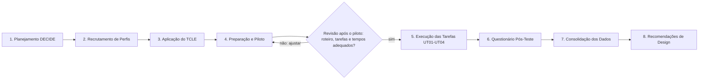

# Entrega 14: Avaliação de usabilidade por observação de usuários

**Data:** 20/11/2026  
**Status:** 🟩 concluída  
**Responsabilidade:** solução consolidada por equipe. O número de participantes finais observados deve ser igual ao número de integrantes, conforme o modelo da disciplina; recomenda-se que cada integrante seja responsável por conduzir/analisar ao menos um participante.

## Objetivo da atividade

Observar usuários representativos realizando tarefas reais ou realisticamente simuladas para identificar problemas de eficácia, eficiência, compreensão e satisfação que não podem ser inferidos apenas por inspeção.

> **Participantes finais não devem ser membros da equipe.** Um integrante pode participar do teste piloto apenas para validar roteiro/equipamentos, sem contar na amostra final.

### Quando o usuário é um perfil profissional especializado

Em TCCs técnicos, o público pode ser DBA, analista, pesquisador, administrador, técnico ou outro especialista. Priorize participantes que possuam relação real com as tarefas. Se não for possível recrutar o perfil ideal, qualquer participante aproximado/proxy deve ser **justificado previamente e tratado como limitação**; não apresente o resultado como equivalente ao de especialistas reais.

O teste avalia a **interação com o protótipo**. Não é necessário que o participante valide o desempenho científico do algoritmo. Resultados simulados podem ser usados quando declarados e coerentes com a tarefa.

Tarefas podem envolver, por exemplo, interpretar um dashboard, configurar uma análise, encontrar uma execução no histórico usando filtros, comparar resultados, gerar relatório, revisar alerta ou administrar permissões.

## A. Fluxograma do processo: equipe

O fluxograma deve representar, no mínimo: planejamento → recrutamento → consentimento → preparação → execução das tarefas/observação → pós-teste → consolidação/análise → recomendações.

## B. Procedimento de preparação e execução: equipe

### Passo 1: Objetivos e versão avaliada

**Versão/commit/Figma:** Versão do 19/11  
**Metas de usabilidade relacionadas:** as metas de P01 da [Entrega 8](08_engenharia_usabilidade.md), medidas na UT01, e a QA05 da [Entrega 12](12_planejamento_avaliacao.md), medida na UT02 e na UT04.

| Meta | O que mede | Critério com 2 participantes |
|---|---|---|
| MU01 | conclusão sem ajuda na UT01 | os 2 concluem sem ajuda |
| MU02 | tempo mediano na UT01 | ≤ 3 min |
| MU03 | SEQ após a UT01 | média ≥ 5,5 |
| MU06 | ponto de partida que respeita a ordem da trilha | nenhum participante indica um tópico que depende de outro |
| QA05 | achar onde estudar um tópico e o que estudar antes dele (UT02 e UT04) | os 2 concluem sem ajuda |

Também são observadas as metas qualitativas da Entrega 8: se o participante reenvia a questão ou desiste durante o processamento e se menciona o aviso de que a IA pode errar.

### Passo 2: Participantes

| ID | Perfil | Critérios que justificam participação | Integrante responsável |
|---|---|---|---|
| U01 | Estudante de ADS no terceiro semestre | Conhecimento de programação mas nunca participou de programação competitiva. É um perfil iniciante. | Juan Manuel Citta |
| U02 | Estudante de Ciência da Computação no 8o Semestre | Já praticou programação competitiva. É um perfil de alguém com conhecimento prévio e que pode julgar melhor as funcionalidades ligadas aos tópicos de programação competitiva. | Sebastian Citta |

U01 corresponde à persona P01. U02 tem mais experiência que P01 e entra como contraste: os resultados dele são lidos à parte e não valem como resultado de um iniciante. Como o U01 não tinha nenhuma experiência em programação competitiva e não encontramos outro participante com o perfil exato de P01, preferimos alguém com um pouco mais de prática, para observar a ferramenta também pelo olhar de quem já conhece os tópicos.

### Passo 3: Consentimento e privacidade

- Termo/registro de consentimento: acordado verbalmente, por chamada, sem gravação armazenada, como permitido pelo professor em aula.
- Gravação de tela/áudio/vídeo: não.
- Forma de anonimização: IDs `U01`, `U02`
- Local e período de armazenamento: Planilha gravada localmente, até o final das provas (03/12).

### Passo 4: Teste piloto

**Data:** 18/11/2026
**O que foi validado:** roteiro, duração, entendimento das instruções e a aplicação na versão testada.  
**Mudanças após piloto:**

| Tarefa | Antes do piloto | Depois do piloto | Motivo |
|---|---|---|---|
| UT01 | 5 min | 3 min | tempo |
| UT02 | Laços de repetição, 2 min | Pilhas e filas, 2 min | Laços de repetição não tem capítulo no CLRS, então a tarefa não tinha um capítulo para encontrar |
| UT03 | 3 min | 1 min | tempo |
| UT04 | 3 min | 2 min | tempo |

No piloto, as 4 tarefas foram concluídas em cerca de 5 minutos no total, e os limites anteriores somavam 13 minutos. Os novos limites somam 8 minutos e deixam uma folga para participantes mais lentos.

### Passo 5: Tarefas

Problema usado: [Weird Algorithm (CSES 1068)](https://cses.fi/problemset/task/1068). Trilha esperada: Variáveis e tipos de dados → Estruturas condicionais (if/else) → Laços de repetição (for/while).

| ID | Cenário/instrução apresentada | Critério de sucesso | Métricas | Ligação com modelo |
|---|---|---|---|---|
| UT01 | "Você está treinando para uma competição e travou neste problema. Use a ferramenta para descobrir por qual assunto começar a estudar e explique por quê." | indica Variáveis e tipos de dados e justifica pela ordem da trilha, em até 3 min | sucesso, tempo, erros, ajudas, satisfação | T01, M01, O01, O02; F01 a F03 |
| UT02 | "Você decidiu que quer estudar o tópico Pilhas e filas, descubra em que capítulo esse tópico se encontra" | diz o capítulo do CLRS mostrado no painel do tópico Pilhas e filas, em até 2 min | sucesso, tempo, erros, ajudas, satisfação | T01, T02, O04; F04, F10 |
| UT03 | "Você ainda não entendeu quando usar um laço que repete sem saber quantas vezes. Tire essa dúvida usando a ferramenta." | obtém uma resposta sobre o assunto, pelo painel do tópico ou pelo chat, em até 1 min | sucesso, tempo, erros, ajudas, satisfação | T01, M01, O06; F06 |
| UT04 | "Um colega comentou sobre caminhos mínimos de origem única. Descubra o que você precisa estudar antes desse assunto." | cita busca em largura (BFS) e heap e heapsort, em até 2 min; o caminho usado é registrado | sucesso, tempo, erros, ajudas, satisfação | T02, M02, O07, O04; F09 a F11 |

### Passo 6: Protocolo do moderador

1. Receber participante e explicar que **o produto está sendo avaliado, não a pessoa**.
2. Obter consentimento.
3. Aplicar perfil pré-teste mínimo necessário.
4. Ler instruções padronizadas.
5. Observar sem ensinar o caminho; registrar pedidos de ajuda separadamente.
6. Se usar *think aloud*, explicar e aplicar de forma consistente.
7. Após cada tarefa, registrar satisfação/SEQ ou escala definida.
8. Fazer pós-teste/entrevista breve.
9. Encerrar e explicar uso dos dados.

## C. Resultados: por participante

Satisfação = SEQ de 1 a 7. Tempo em mm:ss.

### U01: estudante de ADS, 3º semestre, iniciante (P01)

| Tarefa | Grau de sucesso | Erros | Tipos de erro/dificuldade | Ajudas | Tempo | Satisfação | Evidência/observação |
|---|---|---:|---|---:|---|---|---|
| UT01 | 100% | 0 |  Nenhuma | Nenhuma | 1:05 | 5 | O participante já abriu a aplicação com a questão copiada, leu corretamente o local da resposta que indica o porquê dos tópicos caírem|
| UT02 | 100% |  0| Nenhum | Nenhuma | 0:34 | 5 | O participante achou esquisito mudar de tema abruptamente e demorou para achar o tópico |
| UT03 | 100% | 1 | O participante ficou confuso com o botão de "Pergunte sobre o tópico" no painel do tópico  | Nenhuma | 00:40| 4 | Usou o botão de perguntar sobre o tópico mas percebeu que não atendeu exatamente ao que era esperado na tarefa, mas rapidamente foi escrever na aba de chat |
| UT04 | 100% | 0 | Nenhuma dificuldade | Nenhuma | 0:30 | 5 | Encontrou o botão de "Visualizar grafo" rapidamente, tentou arrastar a tela para mover o grafo antes de usar o filtro de "Ajustar a tela" |

**Link da gravação (se autorizado):** não houve gravação; registro só em anotações.  
**Resposta pós-teste:** 

1. Soube. Não senti que nada me atrapalhou, o que me ajudou foi a trilha, ficou bem clara a ordem.
2. Não.
3. Confiaria. Se fosse procurar em outro eu perguntaria para uma IA provavelmente.
4. Hoje não posso dizer para programação competitiva mas sim para a programação em um geral. Normalmente quando eu travo em um trabalho ou algo do tipo tento procurar no Google, porém quando é algo muito especifico ou dificil eu tendo a utilizar IAs.
5. Eu mudaria a tela do grafo de conhecimento, achei ela dificil de navegar.
6. Sim.
### U02: estudante de Ciência da Computação, 8º semestre, com prática em programação competitiva

| Tarefa | Grau de sucesso | Erros | Tipos de erro/dificuldade | Ajudas | Tempo | Satisfação | Evidência/observação |
|---|---|---:|---|---:|---|---|---|
| UT01 | 100% | 0 |  Nenhuma | Nenhuma | 1:01 | 4 | O participante não concordou com a resposta dada pelo modelo|
| UT02 | 100% |  0| | Nenhuma | 0:23 | 5 | Encontrou o tópico rapidamente, já conhecia a ordem de tópicos |
| UT03 | 100% | 0 | Nenhum  | Nenhuma | 00:30 | 5 | Escreveu a resposta diretamente no chat  |
| UT04 | 100% | 0 | Nenhum | Nenhuma | 0:30 | 5 | Demorou mais tempo para achar no grafo do que o tópico de Pilhas e filas. |

**Link da gravação (se autorizado):** não houve gravação; registro só em anotações.  
**Resposta pós-teste:** 

1. Sim. Nada me atrapalhou.
2. Não.
3. Pelo que eu bati o olho parece errar na explicação, pela conversa que tive com vocês é por causa de uma limitação do modelo, por isso eu conferiria em outro lugar antes. Talvez usaria uma IA, mandando o enunciado e os tópicos da trilha para checkar.
4. Hoje eu perguntaria para o professor ou colegas da maratona, mas se estivesse sozinho em casa eu usaria.
5. Melhoraria a precisão da explicação.
6. Sim.

## D. Consolidação por tarefa

| Tarefa | Taxa de sucesso | Tempo típico | Erros recorrentes | Satisfação | Meta atendida? | Problemas prioritários |
|---|---:|---|---|---|---|---|
| UT01 | 2/2 | mediana 1:03 | nenhum | média 4,5 | MU01 sim; MU02 sim; MU03 não; MU06 sim | AU04 |
| UT02 | 2/2 | mediana 0:29 | nenhum | média 5,0 | QA05 sim | AU03 |
| UT03 | 2/2 | mediana 0:35 | 1 erro (U01, botão Perguntar) | média 4,5 | sem meta quantitativa | AU01 |
| UT04 | 2/2 | mediana 0:30 | nenhum | média 5,0 | QA05 sim | AU02, AU03 |

Todos concluíram sem ajuda e bem abaixo dos tempos-limite. A média de SEQ de todas as tarefas foi 4,75.

**Trilha exibida:** nas duas sessões, o modelo gerou a mesma trilha conferida pela equipe, por isso os critérios de sucesso valem igualmente para os dois participantes.

**Metas qualitativas:** nenhum participante reenviou a questão ou desistiu durante o processamento, e nenhum mencionou o aviso de que a IA pode errar.

## E. Achados e recomendações

| ID | Achado | Evidência (quant. + qual.) | Impacto | Recomendação | Artefatos a revisar |
|---|---|---|---|---|---|
| AU01 | "Perguntar sobre este tópico" não responde à dúvida do aluno | 1 erro em 2 na UT03 (U01); SEQ 4; U01 usou o botão, viu que a resposta não atendia e foi para o chat. U02 foi direto ao chat | o iniciante perde tempo e recebe uma resposta genérica; recuperou em 0:40 | ao clicar, preencher o campo do chat com "Sobre <tópico>: " para o aluno completar | MoLIC M01, F06, signos (Entrega 9) |
| AU02 | o usuário espera arrastar o grafo com o mouse | U01 tentou arrastar o grafo na UT04 antes de usar "Ajustar à tela" | pequeno; o aluno contorna, mas quebra um padrão conhecido | permitir arrastar o grafo com o botão esquerdo | MoLIC M02, F09 |
| AU03 | achar um tópico fora da trilha leva mais tempo | U01 demorou para achar Pilhas e filas na UT02 (0:34); U02 demorou mais para achar caminhos mínimos no grafo do que Pilhas e filas (UT04) | pequeno; tempos ainda baixos | destacar "Buscar tópico" e centralizar o grafo no tópico encontrado | MoLIC M02, F09, F10 |
| AU04 | a satisfação na UT01 ficou abaixo da meta | SEQ 5 (U01) e 4 (U02), média 4,5 contra a meta de 5,5; U02 não concordou com a resposta do modelo; nenhum participante citou o aviso de que a IA pode errar | a satisfação depende da confiança no resultado, não só da interface | deixar mais visível "Como esta trilha foi feita" e a fonte de cada tópico; no TCC, revisar a resposta do modelo | Entrega 8 (MU03), signos (Entrega 9), F03 |

## F. Comparação com a avaliação heurística

| Problema | Detectado na heurística? | Detectado por usuários? | O que aprendemos |
|---|---|---|---|
| Não dá para navegar o grafo de conhecimento arrastando a tela | sim | sim | Arrastar a tela é um movimento conhecido pelo usuário para navegar, deve ser levado em consideração para a atualizações futuras da ferramenta |
| "Perguntar sobre este tópico" envia uma pergunta pronta, sem deixar o aluno editar | sim (HC01, severidade 3) | sim (U01, UT03) | o problema é real para o iniciante; o participante experiente nem usou o botão e foi direto ao chat |
| Tópico selecionado e tópico estudado têm a mesma cor azul | sim (HC02, severidade 2) | não | as tarefas não pediam marcar tópico como estudado, por isso não houve como observar. Não aparecer no teste não prova que o problema não existe, e ele continua na lista de correções |
| Achar um tópico fora da trilha leva mais tempo (AU03) | não | sim (U01, U02) | a inspeção olhou cada tela; só o uso mostrou o custo de procurar um tópico no grafo |
| Satisfação ligada à confiança no resultado (AU04) | não | sim (U02) | a heurística não mede confiança; o participante experiente julgou a resposta do modelo |

Os problemas da Entrega 13, inclusive o HC01 (severidade 3), não foram corrigidos antes do teste de propósito, para comparar o que cada método encontra.

## G. Conclusão

1. **Metas atingidas:** MU01 (2 de 2 concluíram a UT01 sem ajuda), MU02 (mediana de 1:03, abaixo de 3 min), MU06 (nenhum ponto de partida errado) e QA05 (UT02 e UT04 concluídas sem ajuda). MU03 não foi atingida: a média de SEQ na UT01 foi 4,5, abaixo de 5,5. Nas metas qualitativas, ninguém reenviou a questão durante o processamento, mas ninguém mencionou o aviso de que a IA pode errar.
2. **Problemas recorrentes:** a navegação no grafo apareceu com os dois perfis (AU02 e AU03), nas tarefas UT02 e UT04. O problema do botão Perguntar (AU01) apareceu só com o iniciante, na UT03.
3. **O que surpreendeu:** as tarefas foram muito mais rápidas que o esperado (nenhuma passou de 1:05). A menor nota do participante experiente veio de discordar do modelo, não da interface.
4. **Mudanças prioritárias:** primeiro AU01 (HC01), depois AU02 (HC03) e AU03. AU04 depende também da qualidade do modelo, que é trabalho do TCC.
5. **Limitações:** foram 2 participantes, e só o U01 é do perfil P01; o U02 é mais experiente e serve de contraste. A amostra é de conveniência, foi usado um único problema, o consentimento foi verbal e não houve gravação. Os participantes falaram em voz alta (*think aloud*), o que pode deixar os tempos um pouco maiores que no uso real. Os resultados indicam tendências e não podem ser generalizados.

## Checklist

- [x] Número de participantes finais atende ao enunciado.
- [x] Participantes são representativos do público e não são membros da equipe.
- [x] Se foram usados participantes proxy, a justificativa e a limitação estão explícitas.
- [x] O teste avalia a interação; não confunde usabilidade do protótipo com desempenho técnico do TCC.
- [x] Tarefas administrativas/analíticas usadas no teste são rastreáveis a objetivos e cenários.
- [x] Há consentimento e anonimização.
- [x] Foi realizado teste piloto.
- [x] Tarefas têm critérios de sucesso definidos antes do teste.
- [x] Moderadores não ensinaram o caminho durante a tarefa.
- [x] Resultados estão separados por usuário e por tarefa.
- [x] Foram registrados sucesso, erros, ajudas, tempo e satisfação quando aplicáveis.
- [x] Conclusão combina evidência quantitativa e qualitativa.
- [x] Achados geram recomendações e atualização da rastreabilidade.
